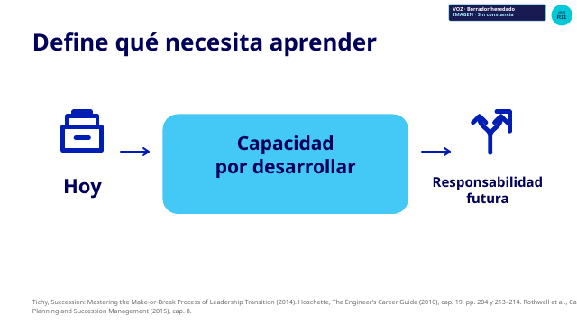

# Lámina 083 · ID PPT 270

## Trazabilidad

- XML de origen: `Sucesion_R11_Large_v10_Deduplicada_2026-11-17_0701_GT.xml` (versión 2; Flat OPC).
- SHA-256 del XML: `a31bc4260d3bf3c96678b66efd5bdf2fbc49dafac046904403b2f81e8c430f2d`.
- Procedencia de la miniatura: Exportada desde una copia con las láminas ocultas incluidas; el XML fuente no se alteró.
- Procedencia de la locución: Notas del XML; esta lámina no estaba en el TXT de las visibles.
- Posición física: **083**; ID nativo: **270**.
- Archivo de imagen: `Sucesion_R11_Large_v10_Deduplicada_2026-11-17_0701_GT__083.png` (640 × 360).
- SHA-256 del PNG: `0a040aa296778e4f7dc8b51bbe0979dc6664e1480f3686fbeb25ede2abf83f3d`.
- Estado: **oculta en el XML; marcado para eliminar**.

## Juicio de Sammy (no es veredicto de Randy)

- **Imagen:** 4/5 · El recuadro celeste hace visible el puente entre hoy y futuro; daría el mismo peso visual a ambos extremos.
- **Locución:** El caso de Carlos aterriza la coordinación entre áreas; reduciría la explicación a evidencia actual, práctica y resultado futuro.
- **Referencia alternativa:** No encontré una alternativa mejor verificada.

## Voz en off

*Texto de las notas de una lámina oculta. No equivale a voz final aprobada.*

El tercer paso es Desarrollo de habilidades. El punto de partida es una capacidad del rol que necesita práctica o que todavía debes observar. Con esa información puedes elegir una experiencia que tenga sentido para el colaborador.

Describe el punto actual y el resultado de aprendizaje. Ambos deben referirse a la misma capacidad. En Carlos, el dominio técnico ya tiene evidencia. Si quieres observar coordinación, explica qué ha podido hacer hasta ahora y qué necesitará demostrar: integrar información de varias áreas, justificar una prioridad y resolver dentro de su autoridad.

Esa descripción evita un objetivo demasiado amplio, como «mejorar su liderazgo». También permite reconocer avances. Podrás observar si reunió la información pertinente, si escuchó las necesidades de las áreas y si logró un acuerdo que todos comprendieron.

Antes de elegir el apoyo, averigua qué explica la dificultad. Tal vez necesita aprender una técnica. Quizá conoce cómo actuar, pero todavía no tuvo una oportunidad. O puede haber encontrado prioridades incompatibles, información incompleta o una autorización pendiente. Conversa sobre lo ocurrido y contrasta las condiciones antes de decidir qué necesita.

Si Carlos no logró un acuerdo porque las áreas nunca recibieron el mismo objetivo, tendrás que aclararlo con sus responsables. Si contó con condiciones suficientes y le costó comprender las posiciones, puede practicar cómo explorar un desacuerdo y construir alternativas. Las dos situaciones necesitan intervenciones diferentes.

Prioriza una capacidad que cambie de manera importante su preparación. Aprender una herramienta puede requerir una práctica guiada. Coordinar intereses distintos puede necesitar varias experiencias, con conversaciones de revisión entre ellas. Ajusta el alcance a la preparación actual y al riesgo de la tarea.

Como mentor, puedes ayudarle a reconocer qué sabe, qué necesita preguntar y cómo elegir una respuesta. Explica tu criterio cuando resulte útil y dale espacio para probar. El desarrollo avanza cuando el colaborador puede usar lo aprendido en una decisión concreta.

Lleva al Plan de Desarrollo Individual, o PDI, la capacidad prioritaria, la evidencia actual y la experiencia que permitirá avanzar. Esa conexión te ayudará a elegir recursos y a comprobar después qué cambió.
