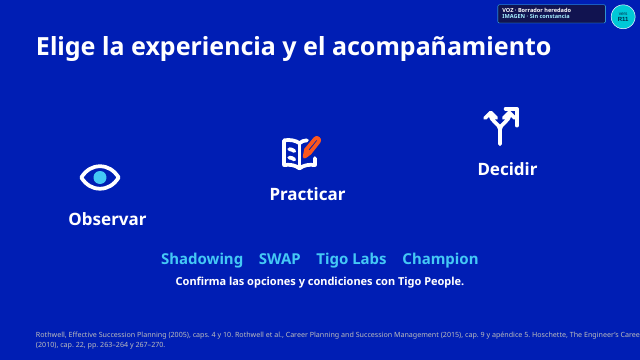

# Lámina 084 · ID PPT 271

## Trazabilidad

- XML de origen: `Sucesion_R11_Large_v10_Deduplicada_2026-11-17_0701_GT.xml` (versión 2; Flat OPC).
- SHA-256 del XML: `a31bc4260d3bf3c96678b66efd5bdf2fbc49dafac046904403b2f81e8c430f2d`.
- Procedencia de la miniatura: Exportada desde una copia con las láminas ocultas incluidas; el XML fuente no se alteró.
- Procedencia de la locución: Notas del XML; esta lámina no estaba en el TXT de las visibles.
- Posición física: **084**; ID nativo: **271**.
- Archivo de imagen: `Sucesion_R11_Large_v10_Deduplicada_2026-11-17_0701_GT__084.png` (640 × 360).
- SHA-256 del PNG: `bfc462cd0f7713ee200136ec0c4ff51b2117ee5e5b7a1dbbe8243936bf9c6a85`.
- Estado: **oculta en el XML; marcado para eliminar**.

## Juicio de Sammy (no es veredicto de Randy)

- **Imagen:** 3/5 · La diagonal de los iconos ordena la secuencia, pero el pie de cuatro programas queda demasiado pequeño para miniatura.
- **Locución:** Los ejemplos nombran modalidades y remiten a Tigo People, sin afirmar disponibilidad; comprobar su vigencia antes de enseñar esas opciones.
- **Referencia alternativa:** No encontré una alternativa mejor verificada.

## Voz en off

*Texto de las notas de una lámina oculta. No equivale a voz final aprobada.*

La experiencia de desarrollo debe permitir practicar la capacidad que elegiste. Un curso puede aportar conocimiento; una responsabilidad real permite utilizarlo. El acompañamiento ayuda a revisar lo que ocurre y a preparar la siguiente decisión.

Puedes combinar apoyos. En coaching, las preguntas ayudan a trabajar una conducta o una habilidad concreta. La mentoría permite compartir experiencia y desarrollar criterio con una mirada de futuro. Un referente de otra área puede aportar una perspectiva que el colaborador todavía no conoce. Lo importante es elegir qué ayuda necesita y quién puede ofrecerla.

El diseño de Bootcamp Develop Program que recoge este curso contempla cuatro modalidades. En Shadowing, el colaborador observa a un referente y después practica con acompañamiento. SWAP propone un intercambio temporal para comprender un proceso de principio a fin. Tigo Labs reúne especialidades alrededor de una necesidad. Champion plantea un proyecto especial que amplía la experiencia. Confirma con Tigo People las opciones y condiciones aplicables antes de acordar una modalidad.

Para Carlos, observar una conversación entre áreas puede ser un buen comienzo. Después necesitará participar: preparar opciones, explicar una recomendación y conducir una decisión dentro de los límites acordados. Cuando demuestre criterio, podrás ampliar gradualmente su responsabilidad.

Al elegir el reto, revisa qué aprenderá, qué condiciones requiere y qué riesgo implica. Una mejora pequeña entre áreas puede ofrecer la práctica necesaria sin asumir todo un puesto. Más tareas del mismo tipo pueden aumentar la carga sin darle una decisión nueva que aprender.

Acuerda qué hará, qué evidencia revisarán y con qué condiciones podrá actuar. Define el tiempo, los accesos autorizados, el apoyo y los asuntos que deberá consultar. Escucha qué necesita Carlos y confirma la participación de quienes facilitarán la experiencia. Si otra área lo recibe, acuerda quién abrirá las oportunidades de práctica y dará retroalimentación.

También conviene explicar las expectativas sobre el acompañamiento. El mentor puede compartir experiencias y hacer preguntas; quien autoriza recursos conserva esa responsabilidad. Protege la confianza de la conversación y acuerda qué avances podrán compartirse, respetando las reglas vigentes.

Mientras practica, permite que Carlos proponga antes de darle tu respuesta. Ante un riesgo de seguridad o una decisión fuera de su autoridad, orienta y acuerda el escalamiento. Así puede aprender con apoyo y asumir gradualmente decisiones que antes solo observaba.
