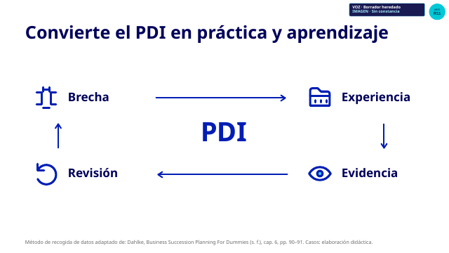

# Lámina 085 · ID PPT 272

## Trazabilidad

- XML de origen: `Sucesion_R11_Large_v10_Deduplicada_2026-11-17_0701_GT.xml` (versión 2; Flat OPC).
- SHA-256 del XML: `a31bc4260d3bf3c96678b66efd5bdf2fbc49dafac046904403b2f81e8c430f2d`.
- Procedencia de la miniatura: Exportada desde una copia con las láminas ocultas incluidas; el XML fuente no se alteró.
- Procedencia de la locución: Notas del XML; esta lámina no estaba en el TXT de las visibles.
- Posición física: **085**; ID nativo: **272**.
- Archivo de imagen: `Sucesion_R11_Large_v10_Deduplicada_2026-11-17_0701_GT__085.png` (640 × 360).
- SHA-256 del PNG: `5c388a290bf62033408996acde8033d6d95a44c886e210d48fd30ba53378084f`.
- Estado: **oculta en el XML; marcado para eliminar**.

## Juicio de Sammy (no es veredicto de Randy)

- **Imagen:** 3/5 · La ruta rectangular se sigue, pero las flechas largas pesan más que los cuatro iconos y el PDI central queda aislado.
- **Locución:** No se exportó locución limpia; si se reutiliza, conviene narrar un ciclo concreto, no leer sus cuatro etiquetas.
- **Referencia alternativa:** No encontré una alternativa mejor verificada.

## Voz en off

*Sin locución publicable separada con certeza de las notas editoriales, o sin notas en el XML.*
