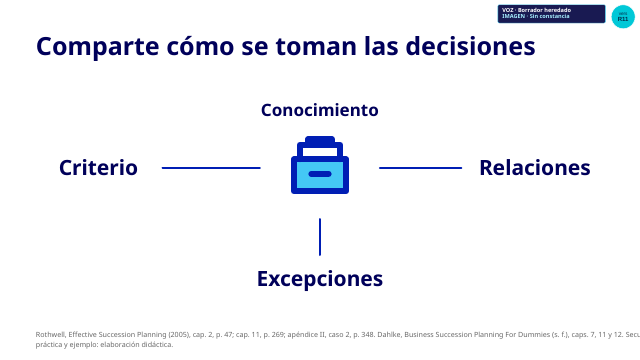

# Lámina 088 · ID PPT 275

## Trazabilidad

- XML de origen: `Sucesion_R11_Large_v10_Deduplicada_2026-11-17_0701_GT.xml` (versión 2; Flat OPC).
- SHA-256 del XML: `a31bc4260d3bf3c96678b66efd5bdf2fbc49dafac046904403b2f81e8c430f2d`.
- Procedencia de la miniatura: Exportada desde una copia con las láminas ocultas incluidas; el XML fuente no se alteró.
- Procedencia de la locución: Notas del XML; esta lámina no estaba en el TXT de las visibles.
- Posición física: **088**; ID nativo: **275**.
- Archivo de imagen: `Sucesion_R11_Large_v10_Deduplicada_2026-11-17_0701_GT__088.png` (640 × 360).
- SHA-256 del PNG: `35047c1783d9727fd20ed5d7f092042d51a4bd43dde0bddeadb43a1cf55a95eb`.
- Estado: **oculta en el XML; marcado para eliminar**.

## Juicio de Sammy (no es veredicto de Randy)

- **Imagen:** 4/5 · El centro y los cuatro radios dejan aire; falta completar arriba la misma conexión visual que tienen los otros tres conceptos.
- **Locución:** La excepción que no aparece en el procedimiento es el mejor ejemplo para transferir criterio; abriría con ella.
- **Referencia alternativa:** No encontré una alternativa mejor verificada.

## Voz en off

*Texto de las notas de una lámina oculta. No equivale a voz final aprobada.*

Transferir conocimiento requiere explicar cómo lo utilizas. Un procedimiento puede describir la secuencia habitual y dejar fuera la señal que te hace detenerte, la relación que necesitas consultar o la excepción que cambia la respuesta.

Empieza por una decisión reciente. Cuenta qué observaste, qué alternativas consideraste y por qué elegiste una. Explica también qué información te habría hecho cambiar de rumbo. El colaborador puede reconstruir ese razonamiento y después practicar una situación comparable, con apoyo y dentro de sus atribuciones.

Comparte las relaciones de trabajo que ayudan a decidir: con quién coordinar, para qué y por qué canal. Presentar a los interlocutores y aclarar los acuerdos facilita la colaboración de quien aprende. Mantén la información y los accesos dentro de lo autorizado.

Puedes comprobar el aprendizaje con una simulación segura. Plantea una situación ficticia que incluya una excepción y acuerda qué observarás. Mira qué información busca, cómo prioriza, cuándo consulta y qué puede resolver. La práctica debe proteger la operación y a los clientes.

Si aparece una dificultad, identifica qué necesita ajustarse. Puede faltar conocimiento, acceso, autoridad o una oportunidad de practicar. Registra lo observado y acuerda la corrección antes de repetir la prueba. La simulación aporta evidencia sobre ese alcance; conserva lo que todavía necesita comprobarse.

Cuando se concrete una transición, prepara las decisiones prioritarias, las herramientas, las relaciones y el apoyo inicial. Comunica quién asume cada responsabilidad y a quién corresponde consultar. El nuevo titular necesita espacio para ejercer sus decisiones, con acompañamiento para lo que siga aprendiendo.

Observa cómo funciona el acuerdo en la práctica. Si el equipo sigue consultando al titular anterior, pregunta qué falta aclarar. Tal vez una autorización, un criterio o una relación todavía necesita transferirse. Ajusta esa condición y revisa la siguiente decisión.

El acompañamiento puede reducirse a medida que exista evidencia de autonomía. Acuerda su alcance y disponibilidad, en lugar de dar por hecho que alguien podrá seguir atendiendo consultas. El propósito es que el nuevo responsable comprenda el trabajo, pueda colaborar con el equipo y sepa utilizar los apoyos que corresponden a su rol.
