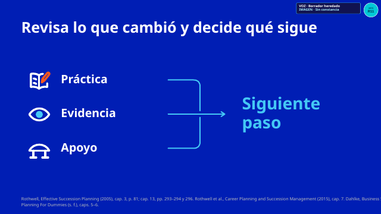

# Lámina 089 · ID PPT 276

## Trazabilidad

- XML de origen: `Sucesion_R11_Large_v10_Deduplicada_2026-11-17_0701_GT.xml` (versión 2; Flat OPC).
- SHA-256 del XML: `a31bc4260d3bf3c96678b66efd5bdf2fbc49dafac046904403b2f81e8c430f2d`.
- Procedencia de la miniatura: Exportada desde una copia con las láminas ocultas incluidas; el XML fuente no se alteró.
- Procedencia de la locución: Notas del XML; esta lámina no estaba en el TXT de las visibles.
- Posición física: **089**; ID nativo: **276**.
- Archivo de imagen: `Sucesion_R11_Large_v10_Deduplicada_2026-11-17_0701_GT__089.png` (640 × 360).
- SHA-256 del PNG: `6a56daf6ee8e76c77f6d962af6bfffadb513ea3648dab3937ee6bbd65f669453`.
- Estado: **oculta en el XML; marcado para eliminar**.

## Juicio de Sammy (no es veredicto de Randy)

- **Imagen:** 4/5 · La llave reúne práctica, evidencia y apoyo con un destino visual claro; ajustar el contraste del trazo celeste.
- **Locución:** La repetición breve de seguimiento funciona mejor si cierra con una decisión concreta ante una práctica pospuesta.
- **Referencia alternativa:** No encontré una alternativa mejor verificada.

## Voz en off

*Texto de las notas de una lámina oculta. No equivale a voz final aprobada.*

El plan necesita seguimiento mientras el aprendizaje ocurre. Una conversación breve puede ayudarte a saber qué práctica se realizó, qué evidencia cambió, qué apoyo falta y cuál será el siguiente paso.

Retoma los acuerdos concretos. Si Carlos coordinó una decisión, revisa qué hizo y qué apoyo utilizó. Si la experiencia se pospuso por una prioridad operativa, acuerda una alternativa o una nueva fecha. La práctica sigue pendiente hasta que ocurra; el seguimiento debe ayudar a hacerla posible.

Anticipa también las oportunidades. Un proyecto transversal puede ofrecer una experiencia valiosa si acuerdas la participación antes de que se distribuyan las responsabilidades. Conecta la capacidad del PDI con el momento del negocio, el apoyo y la revisión. Ajusta el acuerdo si el proyecto cambia.

Al valorar el avance, observa lo que el colaborador puede hacer ahora. Puedes distinguir una capacidad pendiente de observar, una práctica en desarrollo y una preparación que permite organizar una transición acompañada. Son referencias para decidir qué sigue, relacionadas con el rol y la evidencia disponible.

Revisa su interés durante el proceso. Conocer mejor una responsabilidad puede confirmar una aspiración o abrir otra dirección. Escuchar esas preferencias te permite proponer oportunidades útiles y mantener actualizada la identificación de talento.

Para observar el programa en conjunto, considera cuatro señales: cobertura de roles, respaldo de decisiones, autonomía y resultado de las transiciones. La cobertura requiere comprobar preparación, interés y disponibilidad. El respaldo muestra qué decisiones cuentan con apoyo probado. La autonomía se observa dentro de los límites acordados. Las transiciones permiten revisar qué resultados se sostienen y qué acompañamiento permanece.

Antes de pedir un dato, define qué decisión ayudará a tomar. Si comparas cantidades, conserva el mismo alcance, período y criterio. Un curso completado registra una actividad; necesitas observar su aplicación para reconocer aprendizaje. Un caso permite corregir una dificultad, sin representar por sí solo todo el programa.

Cuando una experiencia revele un problema, registra qué ocurrió, qué condición faltó y qué ajuste comprobarás. Si cambia el rol, actualiza la referencia y revisa los acuerdos afectados. Utiliza los instrumentos existentes para conservar hechos, responsables y fechas.

Cada revisión debe dejar una decisión útil: mantener la práctica, ampliar el reto, ajustar el apoyo o explorar otra experiencia. Retómala en el siguiente encuentro para comprobar qué ocurrió.
