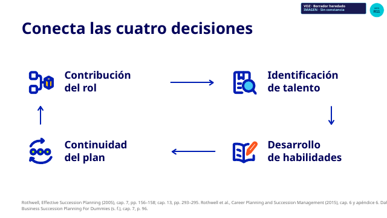

# Lámina 091 · ID PPT 278

## Trazabilidad

- XML de origen: `Sucesion_R11_Large_v10_Deduplicada_2026-11-17_0701_GT.xml` (versión 2; Flat OPC).
- SHA-256 del XML: `a31bc4260d3bf3c96678b66efd5bdf2fbc49dafac046904403b2f81e8c430f2d`.
- Procedencia de la miniatura: Exportada desde una copia con las láminas ocultas incluidas; el XML fuente no se alteró.
- Procedencia de la locución: Notas del XML; esta lámina no estaba en el TXT de las visibles.
- Posición física: **091**; ID nativo: **278**.
- Archivo de imagen: `Sucesion_R11_Large_v10_Deduplicada_2026-11-17_0701_GT__091.png` (640 × 360).
- SHA-256 del PNG: `750585074565435c30e75454f41bb6c053fc7be7abb1a6d75d4c30777fcfc8b9`.
- Estado: **oculta en el XML; marcado para eliminar**.

## Juicio de Sammy (no es veredicto de Randy)

- **Imagen:** 4/5 · Los cuatro iconos se distinguen, pero los tramos de flecha son desiguales; equilibrarlos ayuda a leer el orden sin rodeos.
- **Locución:** La demostración con Carlos une las etapas por una sola exigencia del rol; la priorizaría frente al repaso de nombres.
- **Referencia alternativa:** No encontré una alternativa mejor verificada.

## Voz en off

*Texto de las notas de una lámina oculta. No equivale a voz final aprobada.*

Los cuatro pasos se conectan alrededor del mismo trabajo. La Contribución del rol explica el trabajo que necesitas sostener. La Identificación de talento permite reconocer capacidades e intereses. El Desarrollo de habilidades convierte una necesidad de aprendizaje en una experiencia. La Continuidad del plan mantiene el apoyo, la transferencia y el seguimiento.

En Carlos, la conexión empieza con una exigencia del rol: coordinar decisiones entre áreas. La evidencia muestra dominio técnico y una oportunidad pendiente para observar coordinación. La conversación confirma que quiere explorar esa responsabilidad. El PDI organiza una mejora acotada, con apoyo y límites. El seguimiento permite revisar qué aprendió y qué puede asumir después.

Si la experiencia cambia, revisa las piezas afectadas. Un proyecto cancelado puede requerir otra oportunidad de práctica. Una capacidad nueva del puesto puede modificar el aprendizaje prioritario. Un cambio de interés puede orientar el desarrollo hacia otra trayectoria. Mantén lo que sigue siendo válido y ajusta lo necesario.

Comprueba la calidad del plan con preguntas concretas. ¿Qué resultado necesita sostener el rol? ¿Qué hechos sostienen la valoración del colaborador? ¿La experiencia permite practicar la capacidad elegida? ¿Quién facilitará las condiciones y revisará lo aprendido? Si una respuesta falta, déjala identificada y acuerda cómo obtenerla.

Un registro útil permite comprender la decisión y retomarla. Conserva lo que sabes, lo que necesitas comprobar y el siguiente acuerdo. Así el plan puede orientar tu acompañamiento y ayudar al colaborador a entender cómo está avanzando.
