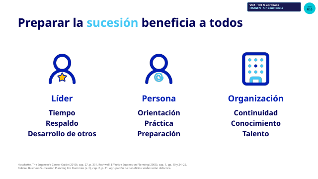

# Lámina 094 · ID PPT 345

## Trazabilidad

- XML de origen: `Sucesion_R11_Large_v10_Deduplicada_2026-11-17_0701_GT.xml` (versión 2; Flat OPC).
- SHA-256 del XML: `a31bc4260d3bf3c96678b66efd5bdf2fbc49dafac046904403b2f81e8c430f2d`.
- Procedencia de la miniatura: Exportada desde una copia con las láminas ocultas incluidas; el XML fuente no se alteró.
- Procedencia de la locución: Notas del XML; esta lámina no estaba en el TXT de las visibles.
- Posición física: **094**; ID nativo: **345**.
- Archivo de imagen: `Sucesion_R11_Large_v10_Deduplicada_2026-11-17_0701_GT__094.png` (640 × 360).
- SHA-256 del PNG: `9ead9ee99d836f614a037aa4bbcfd94e1938e1f1d13e10d8783b393c1b7f379a`.
- Estado: **oculta en el XML; marcado para eliminar**.

## Juicio de Sammy (no es veredicto de Randy)

- **Imagen:** 4/5 · Tres columnas legibles y coherentes, aunque las palabras pequeñas tienen poco aire alrededor de las figuras.
- **Locución:** La voz ya marcada como aprobada abre con desarrollar a otra persona; conserva esa idea como entrada y evita enumerar las columnas.
- **Referencia alternativa:** No encontré una alternativa mejor verificada.

## Voz en off

*Texto de las notas de una lámina oculta. No equivale a voz final aprobada.*

Preparar tu sucesión empieza con el desarrollo de otra persona. Cuando un colaborador aprende a resolver una responsabilidad que antes te consultaba, puedes dedicar más atención a las prioridades que necesitan tu experiencia. También cuentas con respaldo para asumir nuevos retos y puedes reconocer tu contribución en lo que otros aprendieron a hacer.

Para el colaborador, el proceso ofrece una referencia sobre qué necesita desarrollar, oportunidades de práctica con apoyo y evidencias de su preparación.

La organización resguarda conocimiento, fortalece la continuidad del trabajo y conoce mejor el talento con el que puede responder a nuevas necesidades.
