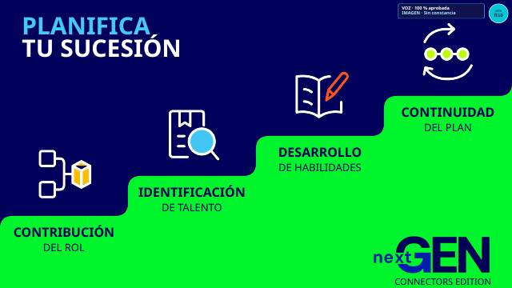

# Lámina 095 · ID PPT 346

## Trazabilidad

- XML de origen: `Sucesion_R11_Large_v10_Deduplicada_2026-11-17_0701_GT.xml` (versión 2; Flat OPC).
- SHA-256 del XML: `a31bc4260d3bf3c96678b66efd5bdf2fbc49dafac046904403b2f81e8c430f2d`.
- Procedencia de la miniatura: Exportada desde una copia con las láminas ocultas incluidas; el XML fuente no se alteró.
- Procedencia de la locución: Notas del XML; esta lámina no estaba en el TXT de las visibles.
- Posición física: **095**; ID nativo: **346**.
- Archivo de imagen: `Sucesion_R11_Large_v10_Deduplicada_2026-11-17_0701_GT__095.png` (640 × 360).
- SHA-256 del PNG: `c085393f1ef83fbdc4dac88b2bd6668bfcf48c4125c594d45cfc40813cc89c28`.
- Estado: **oculta en el XML; marcado para eliminar**.

## Juicio de Sammy (no es veredicto de Randy)

- **Imagen:** 5/5 · La escalera verde convierte la progresión en una figura memorable; los cuatro pictogramas apartan una etapa de la siguiente.
- **Locución:** La voz marcada como aprobada presenta los cuatro pasos en orden; acompasar cada rótulo con su frase sin añadir otra lista.
- **Referencia alternativa:** No encontré una alternativa mejor verificada.

## Voz en off

*Texto de las notas de una lámina oculta. No equivale a voz final aprobada.*

Te presentamos el programa NextGen. Consta de cuatro pasos que te ayudarán a planificar tu sucesión.

Comienza analizando las funciones de tu propio rol y actualiza el modelo de contribución al puesto que ya conoces.

Después, identifica en tu equipo al talento que podría prepararse para asumir ese rol, considerando interés y habilidades demostradas.

Analiza sus brechas y planifica experiencias que le permitan desarrollar esas habilidades necesarias.

Tu liderazgo también se refleja en cómo das continuidad al programa, acompañando el desarrollo y documentando la transformación profesional de tu sucesor.
