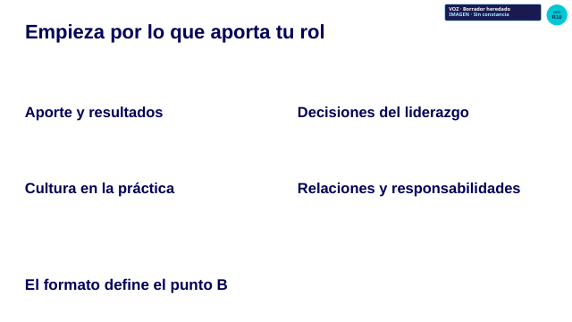

# Lámina 097 · ID PPT 348

## Trazabilidad

- XML de origen: `Sucesion_R11_Large_v10_Deduplicada_2026-11-17_0701_GT.xml` (versión 2; Flat OPC).
- SHA-256 del XML: `a31bc4260d3bf3c96678b66efd5bdf2fbc49dafac046904403b2f81e8c430f2d`.
- Procedencia de la miniatura: Exportada desde una copia con las láminas ocultas incluidas; el XML fuente no se alteró.
- Procedencia de la locución: Notas del XML; esta lámina no estaba en el TXT de las visibles.
- Posición física: **097**; ID nativo: **348**.
- Archivo de imagen: `Sucesion_R11_Large_v10_Deduplicada_2026-11-17_0701_GT__097.png` (640 × 360).
- SHA-256 del PNG: `f431f58ec27be9f51a2ef46452ace50bdf2e8f025f59bdf57e1cf752ecf9fd9a`.
- Estado: **oculta en el XML; marcado para eliminar**.

## Juicio de Sammy (no es veredicto de Randy)

- **Imagen:** 2/5 · El cuadro de dos columnas carece de apoyos gráficos y deja aislado el punto B; se parece a una plantilla sin resolver.
- **Locución:** La comparación entre vender y liderar aporta más que el arranque retrospectivo; iría antes de explicar el formato.
- **Referencia alternativa:** No encontré una alternativa mejor verificada.

## Voz en off

*Texto de las notas de una lámina oculta. No equivale a voz final aprobada.*

En módulos anteriores de Soy Líder Tigo definimos nuestro modelo de contribución al puesto. Seguramente lo trabajaste para los integrantes de tu equipo, analizando sus funciones y requisitos. En esta ocasión deberás revisar el formato de tu propio rol, siempre acordándolo con tu líder inmediato.

Redacta cómo se define tu aporte diario a la compañía y qué decisiones debes tomar en tu liderazgo. Muestra cómo se refleja en las acciones que tomas y en los resultados, e identifica las responsabilidades críticas.

Piensa en un vendedor que podría prepararse para liderar un equipo comercial como tú lo haces hoy. En este ejemplo, Juan atiende a sus clientes y cumple sus metas con alto desempeño. Sin embargo, eso no garantiza que esté preparado para orientar a otros vendedores, analizar indicadores globales, definir metas y darles seguimiento, respondiendo por los resultados del conjunto. Este tipo de cambios te ayudará a especificar lo que necesita aprender tu sucesor.

La cultura también se refleja en cómo decides, reconoces una contribución y resuelves desacuerdos, así como en el trato a clientes internos o externos y la memoria histórica respecto a prioridades y dificultades que permite anticipar soluciones.

Enumera las áreas con las que se debe interactuar o las personas importantes con las que alguien de tu puesto debería relacionarse, y menciona cómo se delegan o distribuyen las responsabilidades.

El resultado de tu formato debe permitir entender cómo funciona tu puesto para establecerlo como nuestro punto B en el análisis de brecha en las siguientes fases.
