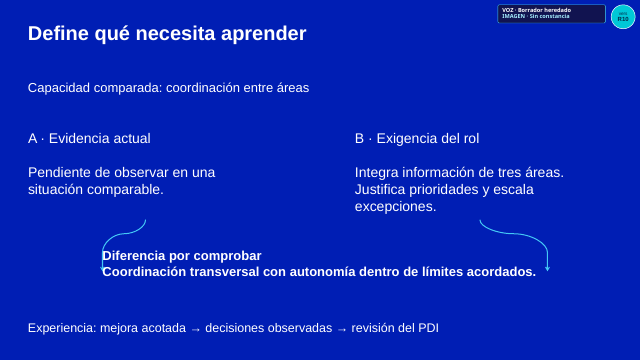

# Lámina 100 · ID PPT 351

## Trazabilidad

- XML de origen: `Sucesion_R11_Large_v10_Deduplicada_2026-11-17_0701_GT.xml` (versión 2; Flat OPC).
- SHA-256 del XML: `a31bc4260d3bf3c96678b66efd5bdf2fbc49dafac046904403b2f81e8c430f2d`.
- Procedencia de la miniatura: Exportada desde una copia con las láminas ocultas incluidas; el XML fuente no se alteró.
- Procedencia de la locución: Notas del XML; esta lámina no estaba en el TXT de las visibles.
- Posición física: **100**; ID nativo: **351**.
- Archivo de imagen: `Sucesion_R11_Large_v10_Deduplicada_2026-11-17_0701_GT__100.png` (640 × 360).
- SHA-256 del PNG: `fd9faf03738820dccb3c4badba54e5045b1a9e36472e6c14067f7cf34a3b7e7b`.
- Estado: **oculta en el XML; marcado para eliminar**.

## Juicio de Sammy (no es veredicto de Randy)

- **Imagen:** 3/5 · Las columnas A y B hacen visible la comparación; los dos arcos flojos y el pie minúsculo diluyen el punto de encuentro.
- **Locución:** Sin voz exportable; narrar una diferencia observable y la práctica que la pondrá a prueba, sin leer las dos columnas.
- **Referencia alternativa:** No encontré una alternativa mejor verificada.

## Voz en off

*Sin locución publicable separada con certeza de las notas editoriales, o sin notas en el XML.*
