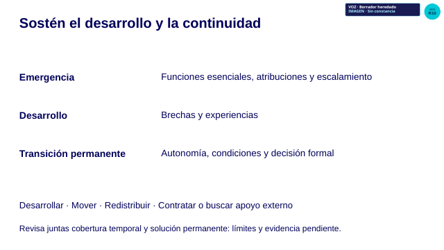

# Lámina 101 · ID PPT 352

## Trazabilidad

- XML de origen: `Sucesion_R11_Large_v10_Deduplicada_2026-11-17_0701_GT.xml` (versión 2; Flat OPC).
- SHA-256 del XML: `a31bc4260d3bf3c96678b66efd5bdf2fbc49dafac046904403b2f81e8c430f2d`.
- Procedencia de la miniatura: Exportada desde una copia con las láminas ocultas incluidas; el XML fuente no se alteró.
- Procedencia de la locución: Notas del XML; esta lámina no estaba en el TXT de las visibles.
- Posición física: **101**; ID nativo: **352**.
- Archivo de imagen: `Sucesion_R11_Large_v10_Deduplicada_2026-11-17_0701_GT__101.png` (640 × 360).
- SHA-256 del PNG: `8606fdb0d6fcf81cc73eb21667b66d3f9738e7a610ee1f734e858dc995a70458`.
- Estado: **oculta en el XML; marcado para eliminar**.

## Juicio de Sammy (no es veredicto de Randy)

- **Imagen:** 2/5 · La composición de tabla tiene demasiado texto lineal sin memoria gráfica; separar los tres escenarios con iconos o bandas.
- **Locución:** Sin voz exportable; necesita una distinción hablada clara entre cubrir un imprevisto y tomar una decisión permanente.
- **Referencia alternativa:** No encontré una alternativa mejor verificada.

## Voz en off

*Sin locución publicable separada con certeza de las notas editoriales, o sin notas en el XML.*
