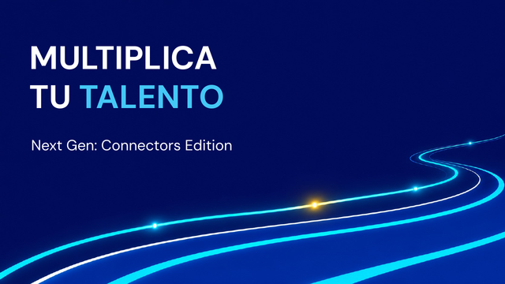

# 005 · Multiplica tu Talento

Montaje de rescates · pendiente de conciliación. Las propuestas fueron aprobadas; esta ficha no añade una aprobación humana del resultado.

## Voz en off literal

Te damos la bienvenida al curso Next Gen: Connectors Edition.

Esto es Multiplica tu Talento.

## Trazabilidad

| Campo | Valor |
|---|---|
| PPT exacta | `Sucesion_R13_Rescates_aprobados_PENDIENTE_CONCILIACION.pptx` |
| Versión | Montaje de 36 diapositivas realizado sobre R13 versión 6; no sustituye la R13 vigente |
| SHA-256 de la PPT | `73e337f32d15efca401fa11cb2111bce79a00f55f060b7a0baaf676c9634f32a` |
| Posición física en esta PPT | 005 |
| ID nativo | 260 |
| Estado original | Visible |
| PNG exacto | `R13_Rescates_aprobados_73e337f3__005.png` |
| SHA-256 del PNG publicado | `fc36b967eb93a364123cb7c1f86fc5e8d893004a67d01bc703f68641fb0fc6d0` |
| Dimensiones | 640 × 360 px, PNG RGB |
| Exportación | Render final de LibreOffice a 1280 × 720; reducción proporcional Lanczos3 a 640 × 360 con sharp 0.35.5, sin volver a renderizar la PPT |
| SHA-256 del render de producción | `5150405026d55af1935df1db70428b9ae2c6d25c497cc30c50c89b95d4991049` |
| Voz | Literal de R13 versión 6; metadatos y notas de producción excluidos |
| SHA-256 de la voz UTF-8 | `f79b0e30f09de61668435e53671d7a2897cd8a39ae4d83750677d0c8aa27d8bf` |
| Referencia del rescate | `NextGen_R12_experimento_visual_73_ENTREGA.pptx`, 73 diapositivas, posición 002, ID nativo 257 |
| SHA-256 de R12 | `7a69815752a0187f932c52349fe710e1d55c1190b393cd9cccf9a9c67b0da430` |
| Aprobación y publicación | Propuesta aprobada por Randy; imagen del montaje publicada para revisión, sin modificar R13 |

La miniatura de una variante anterior de R13 en esta posición fue retirada. **Imagen eliminada** para aquella variante: este PNG es una composición nueva, identificada por su PPT y huella, y no restaura el archivo retirado.

## Juicio visual de Sammy · criterio 080

**5 · Aprobadísima.** El titular blanco y cian forma un bloque dominante y las trayectorias curvas equilibran el vacío sin invadir la lectura.

Cambio mínimo propuesto, no ejecutado: Sin cambios.

La acción es el nombre de la escala, no una orden aplicada ni un veredicto nuevo de Randy. No se ha verificado una alternativa pública adicional en esta entrega.

## Juicio de locución de Sammy

Bienvenida breve y pronunciable, dirigida al participante mediante «te», que presenta oralmente el nombre del curso sin añadir explicación innecesaria a la portada.

Este juicio queda fuera del guion y no modifica la locución literal.

