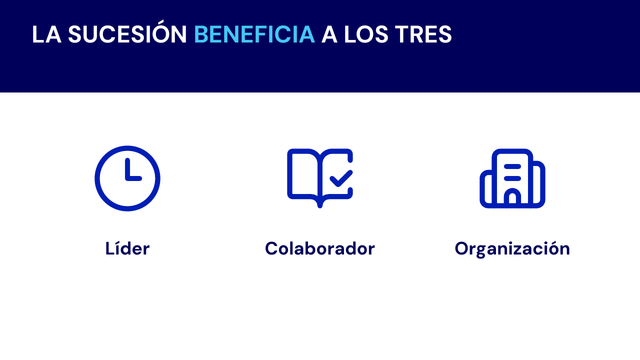

# 006 · La sucesión beneficia a los tres

Montaje de rescates · pendiente de conciliación. Las propuestas fueron aprobadas; esta ficha no añade una aprobación humana del resultado.

## Voz en off literal

Preparar tu sucesión empieza con el desarrollo de otra persona. Cuando un colaborador aprende a resolver una responsabilidad que antes te consultaba, puedes dedicar más atención a las prioridades que necesitan tu experiencia. También cuentas con respaldo para asumir nuevos retos y puedes reconocer tu contribución en lo que otros aprendieron a hacer.

Para el colaborador, el proceso ofrece una referencia sobre qué necesita desarrollar, oportunidades de práctica con apoyo y evidencias de su preparación.

La organización resguarda conocimiento, fortalece la continuidad del trabajo y conoce mejor el talento con el que puede responder a nuevas necesidades.

## Trazabilidad

| Campo | Valor |
|---|---|
| PPT exacta | `Sucesion_R13_Rescates_aprobados_PENDIENTE_CONCILIACION.pptx` |
| Versión | Montaje de 36 diapositivas realizado sobre R13 versión 6; no sustituye la R13 vigente |
| SHA-256 de la PPT | `73e337f32d15efca401fa11cb2111bce79a00f55f060b7a0baaf676c9634f32a` |
| Posición física en esta PPT | 006 |
| ID nativo | 261 |
| Estado original | Visible |
| PNG exacto | `R13_Rescates_aprobados_73e337f3__006.png` |
| SHA-256 del PNG publicado | `44cf1a5e0a4b01986729c8a7338f4d9f69cae3cda28b05b95c675f24ed6611eb` |
| Dimensiones | 640 × 360 px, PNG RGB |
| Exportación | Render final de LibreOffice a 1280 × 720; reducción proporcional Lanczos3 a 640 × 360 con sharp 0.35.5, sin volver a renderizar la PPT |
| SHA-256 del render de producción | `1cf0ccef79c737e889024011a62147d919b755b4919b5939b8ce9366c3ec640a` |
| Voz | Literal de R13 versión 6; metadatos y notas de producción excluidos |
| SHA-256 de la voz UTF-8 | `c6f23a134caf1617d416d5ac213af9aede3d442201be988bdfc21ced9fc9b059` |
| Referencia del rescate | `NextGen_R12_experimento_visual_73_ENTREGA.pptx`, 73 diapositivas, posición 003, ID nativo 287 |
| SHA-256 de R12 | `7a69815752a0187f932c52349fe710e1d55c1190b393cd9cccf9a9c67b0da430` |
| Aprobación y publicación | Propuesta aprobada por Randy; imagen del montaje publicada para revisión, sin modificar R13 |

## Juicio visual de Sammy · criterio 080

**4 · Pulirla.** La fila abierta de tres iconos mantiene una familia gráfica coherente y buen contraste, aunque deja un vacío inferior algo mayor que el superior.

Cambio mínimo propuesto, no ejecutado: Ajustar ligeramente el centro vertical de la fila de iconos y etiquetas, sin cambiar sus proporciones relativas.

La acción es el nombre de la escala, no una orden aplicada ni un veredicto nuevo de Randy. No se ha verificado una alternativa pública adicional en esta entrega.

## Juicio de locución de Sammy

Narración en tuteo que desarrolla los beneficios detrás de los tres rótulos de pantalla y permite distinguir líder, colaborador y organización mediante las pausas entre párrafos.

Este juicio queda fuera del guion y no modifica la locución literal.

