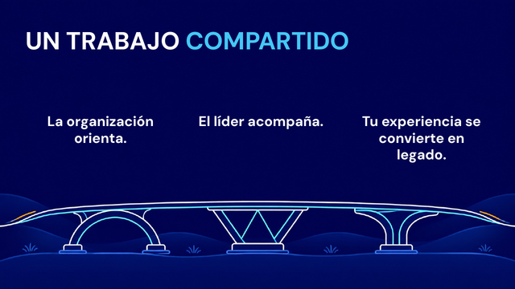

# 007 · Un trabajo compartido

Montaje de rescates · pendiente de conciliación. Las propuestas fueron aprobadas; esta ficha no añade una aprobación humana del resultado.

## Voz en off literal

Estos beneficios son el fruto de la sinergia entre los roles que debe asumir cada uno en el programa de Next Gen.

La organización pone este programa a tu disposición, con una estructura y modelos validados para orientar el desarrollo de tu sucesor, asesorándote en el camino.

Tú como líder emplearás tu experiencia y criterio para construir tu legado a través de este programa, dedicando tiempo a las conversaciones y planes, y motivando a tu sucesor a avanzar.

## Trazabilidad

| Campo | Valor |
|---|---|
| PPT exacta | `Sucesion_R13_Rescates_aprobados_PENDIENTE_CONCILIACION.pptx` |
| Versión | Montaje de 36 diapositivas realizado sobre R13 versión 6; no sustituye la R13 vigente |
| SHA-256 de la PPT | `73e337f32d15efca401fa11cb2111bce79a00f55f060b7a0baaf676c9634f32a` |
| Posición física en esta PPT | 007 |
| ID nativo | 262 |
| Estado original | Visible |
| PNG exacto | `R13_Rescates_aprobados_73e337f3__007.png` |
| SHA-256 del PNG publicado | `7eeb75a1e35e98fd82d1d0309221de47d71c92db9da79d460e9487fd3f9e4bf6` |
| Dimensiones | 640 × 360 px, PNG RGB |
| Exportación | Render final de LibreOffice a 1280 × 720; reducción proporcional Lanczos3 a 640 × 360 con sharp 0.35.5, sin volver a renderizar la PPT |
| SHA-256 del render de producción | `51ee0d102eaccf3185ac66e1d099b8f1340a60d33bdf227d803112628c8f2803` |
| Voz | Literal de R13 versión 6; metadatos y notas de producción excluidos |
| SHA-256 de la voz UTF-8 | `5f581cbfaca911f0b321b2fd8abe06037b0642cdd3083d7ad7906a586a821e54` |
| Referencia del rescate | `NextGen_R12_experimento_visual_73_ENTREGA.pptx`, 73 diapositivas, posición 004, ID nativo 288 |
| SHA-256 de R12 | `7a69815752a0187f932c52349fe710e1d55c1190b393cd9cccf9a9c67b0da430` |
| Aprobación y publicación | Propuesta aprobada por Randy; imagen del montaje publicada para revisión, sin modificar R13 |

La miniatura de una variante anterior de R13 en esta posición fue retirada. **Imagen eliminada** para aquella variante: este PNG es una composición nueva, identificada por su PPT y huella, y no restaura el archivo retirado.

## Juicio visual de Sammy · criterio 080

**4 · Pulirla.** El puente de tres apoyos aporta una silueta reconocible, pero las etiquetas de una, dos y tres líneas dejan alturas visuales desiguales sobre el arte.

Cambio mínimo propuesto, no ejecutado: Equilibrar ópticamente la altura y la distancia de los tres bloques de texto respecto al puente.

La acción es el nombre de la escala, no una orden aplicada ni un veredicto nuevo de Randy. No se ha verificado una alternativa pública adicional en esta entrega.

## Juicio de locución de Sammy

Narración dirigida al líder que amplía el reparto de responsabilidades de la pantalla, aunque la frase sobre la organización concentra varias ideas y necesita una pausa oral antes de pasar a lo que harás tú.

Este juicio queda fuera del guion y no modifica la locución literal.

