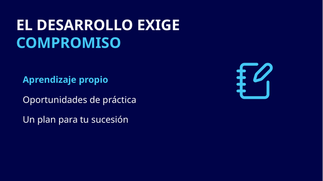

# 008 · El desarrollo exige compromiso

Montaje de rescates · pendiente de conciliación. Las propuestas fueron aprobadas; esta ficha no añade una aprobación humana del resultado.

## Actualización vigente · Decisión036 · 2026-11-23

Randy conserva PROGRAMA007 en R13B y traslada únicamente el puente a **R13B Addendum, posición021**, sin textos ni locución, para reutilización. El puente fue retirado de esta diapositiva donante. Se preservan su texto, su locución y los demás elementos; el fondo de sustitución es azul sólido `#010349`, tomado del fondo del recurso original.

- PPT donante actualizada sobre la misma identidad: versión 8; SHA-256 `a531c16f5598640bf477b4cbaab7d168c3b3b91d10353180ba23a98f62ec1c9a`.
- Posición de esta diapositiva: 008; la posición no sustituye un ID editorial. No se asigna un ID editorial nuevo.
- PNG actual: render de la PPT sin el puente, 640 × 360 px; SHA-256 `e25840862ac79b5dca51cb87d0cf43fa3d48aa53ef976d3f4761ff2be8387c86`. Nombre y URL conservados para evitar copias activas y enlaces rotos. El segmento `73e337f3`, cuando aparece en el nombre, identifica el linaje de publicación original, no el hash de la PPT actual.
- Exportación actual: LibreOffice → PDF → PNG; reducción Lanczos a 640 × 360, RGB. Comprobación técnica, sin nueva aprobación editorial del diseño donante.
- La trazabilidad y los juicios anteriores se conservan abajo como historial. Sus hashes, versiones y comentarios visuales describen la imagen anterior; no son los valores ni el veredicto de este PNG actualizado. La voz literal no cambia.
- Recuperación: versiones anteriores de la PPT y commit público anterior `e7cdb79241970628b828f956bafa0b2f87f01602`. No se mantiene otra copia activa del puente en este archivo.

## Voz en off literal

El colaborador que designes como sucesor será el principal responsable de su propio desarrollo. Le corresponde aceptar la iniciativa y comprometerse con su aprendizaje, sabiendo que requerirá dedicarle esfuerzo, tiempo y otros recursos.

Ese compromiso lo ayudará a estar preparado para aprovechar las oportunidades que puedan surgir.

Al terminar el recorrido, podrás usar los formatos del curso para preparar tu propio plan de sucesión.

## Trazabilidad

| Campo | Valor |
|---|---|
| PPT exacta | `Sucesion_R13_Rescates_aprobados_PENDIENTE_CONCILIACION.pptx` |
| Versión | Montaje de 36 diapositivas realizado sobre R13 versión 6; no sustituye la R13 vigente |
| SHA-256 de la PPT | `73e337f32d15efca401fa11cb2111bce79a00f55f060b7a0baaf676c9634f32a` |
| Posición física en esta PPT | 008 |
| ID nativo | 263 |
| Estado original | Visible |
| PNG exacto | `R13_Rescates_aprobados_73e337f3__008.png` |
| SHA-256 del PNG publicado | `b2643fd88a7fb56fc55064c6156188c7fc6c766d33e0e45166f18d653090e0cf` |
| Dimensiones | 640 × 360 px, PNG RGB |
| Exportación | Render final de LibreOffice a 1280 × 720; reducción proporcional Lanczos3 a 640 × 360 con sharp 0.35.5, sin volver a renderizar la PPT |
| SHA-256 del render de producción | `8899e332b9738caea357264e8ea90cc840602c971e56a845c7e78158a05f0341` |
| Voz | Literal de R13 versión 6; metadatos y notas de producción excluidos |
| SHA-256 de la voz UTF-8 | `8c4ab7904622d0d73fa0385ce575fedb07d77b715fe22d37adca37a5a3e2ed53` |
| Referencia del rescate | `NextGen_R12_experimento_visual_73_ENTREGA.pptx`, 73 diapositivas, posición 004, ID nativo 288 |
| SHA-256 de R12 | `7a69815752a0187f932c52349fe710e1d55c1190b393cd9cccf9a9c67b0da430` |
| Aprobación y publicación | Propuesta aprobada por Randy; imagen del montaje publicada para revisión, sin modificar R13 |

La miniatura de una variante anterior de R13 en esta posición fue retirada. **Imagen eliminada** para aquella variante: este PNG es una composición nueva, identificada por su PPT y huella, y no restaura el archivo retirado.

## Juicio visual de Sammy · criterio 080

**3 · Afinarla.** El puente fino y el cuaderno de trazo grueso compiten como dos focos de distinto peso junto al bloque de texto.

Cambio mínimo propuesto, no ejecutado: Reducir el peso óptico del cuaderno y ampliar el aire entre el último renglón y el puente, conservando ambos recursos.

La acción es el nombre de la escala, no una orden aplicada ni un veredicto nuevo de Randy. No se ha verificado una alternativa pública adicional en esta entrega.

## Juicio de locución de Sammy

Narración en tuteo que explica el esfuerzo y la responsabilidad del colaborador, complementando las etiquetas de pantalla sin convertir la preparación en una promesa de ascenso.

Este juicio queda fuera del guion y no modifica la locución literal.

