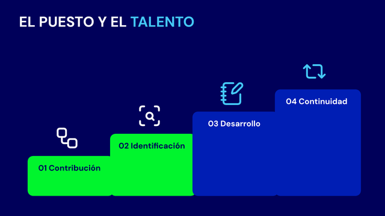

# 009 · El puesto y el talento

Montaje de rescates · pendiente de conciliación. Las propuestas fueron aprobadas; esta ficha no añade una aprobación humana del resultado.

## Voz en off literal

Te presentamos el programa NextGen. Consta de cuatro pasos que te ayudarán a planificar tu sucesión.

Comienza analizando las funciones de tu propio rol y actualiza el modelo de contribución al puesto que ya conoces.

Después, identifica en tu equipo al talento que podría prepararse para asumir ese rol, considerando interés y habilidades demostradas.

## Trazabilidad

| Campo | Valor |
|---|---|
| PPT exacta | `Sucesion_R13_Rescates_aprobados_PENDIENTE_CONCILIACION.pptx` |
| Versión | Montaje de 36 diapositivas realizado sobre R13 versión 6; no sustituye la R13 vigente |
| SHA-256 de la PPT | `73e337f32d15efca401fa11cb2111bce79a00f55f060b7a0baaf676c9634f32a` |
| Posición física en esta PPT | 009 |
| ID nativo | 264 |
| Estado original | Visible |
| PNG exacto | `R13_Rescates_aprobados_73e337f3__009.png` |
| SHA-256 del PNG publicado | `4f923002fb8b3d3e6a356bfa7684fe0bbe5c5fcde963b42c16e7ffee312d8ce7` |
| Dimensiones | 640 × 360 px, PNG RGB |
| Exportación | Render final de LibreOffice a 1280 × 720; reducción proporcional Lanczos3 a 640 × 360 con sharp 0.35.5, sin volver a renderizar la PPT |
| SHA-256 del render de producción | `dac258b1b245cb474e01303054237ab9a4c5e3052e4926c84ab351d226da9af5` |
| Voz | Literal de R13 versión 6; metadatos y notas de producción excluidos |
| SHA-256 de la voz UTF-8 | `e7f14b0bddd011ee97da2c3ff993d4e14b232d468a0abd17ee77ec6a8cbd1bda` |
| Referencia del rescate | `NextGen_R12_experimento_visual_73_ENTREGA.pptx`, 73 diapositivas, posición 006, ID nativo 290 |
| SHA-256 de R12 | `7a69815752a0187f932c52349fe710e1d55c1190b393cd9cccf9a9c67b0da430` |
| Aprobación y publicación | Propuesta aprobada por Randy; imagen del montaje publicada para revisión, sin modificar R13 |

## Juicio visual de Sammy · criterio 080

**5 · Aprobadísima.** La escalera continua, los dos peldaños verdes y los iconos de trazo uniforme producen una silueta clara y reconocible en miniatura.

Cambio mínimo propuesto, no ejecutado: Sin cambios.

La acción es el nombre de la escala, no una orden aplicada ni un veredicto nuevo de Randy. No se ha verificado una alternativa pública adicional en esta entrega.

## Juicio de locución de Sammy

Guía en tuteo, sin diálogo, que presenta los cuatro momentos y desarrolla los dos primeros mientras la escalera mantiene visible la ruta completa.

Este juicio queda fuera del guion y no modifica la locución literal.

