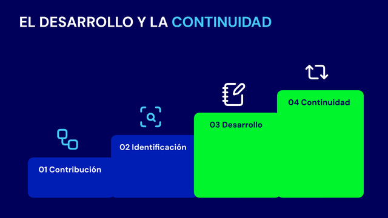

# 010 · El desarrollo y la continuidad

Montaje de rescates · pendiente de conciliación. Las propuestas fueron aprobadas; esta ficha no añade una aprobación humana del resultado.

## Voz en off literal

Analiza sus brechas y planifica experiencias que le permitan desarrollar esas habilidades necesarias.

Tu liderazgo también se refleja en cómo das continuidad al programa, acompañando el desarrollo y documentando la transformación profesional de tu sucesor.

Estos cuatro pasos son nuestra adaptación del modelo de sucesión de William Rothwell.

## Trazabilidad

| Campo | Valor |
|---|---|
| PPT exacta | `Sucesion_R13_Rescates_aprobados_PENDIENTE_CONCILIACION.pptx` |
| Versión | Montaje de 36 diapositivas realizado sobre R13 versión 6; no sustituye la R13 vigente |
| SHA-256 de la PPT | `73e337f32d15efca401fa11cb2111bce79a00f55f060b7a0baaf676c9634f32a` |
| Posición física en esta PPT | 010 |
| ID nativo | 265 |
| Estado original | Visible |
| PNG exacto | `R13_Rescates_aprobados_73e337f3__010.png` |
| SHA-256 del PNG publicado | `fc137e68faf05fd8da3b6e70b554c2e14544e709ae4d2076098d700fe0823ed3` |
| Dimensiones | 640 × 360 px, PNG RGB |
| Exportación | Render final de LibreOffice a 1280 × 720; reducción proporcional Lanczos3 a 640 × 360 con sharp 0.35.5, sin volver a renderizar la PPT |
| SHA-256 del render de producción | `b0466a78b827241c8dc92ebdab82cc3c3c9f105a6d3e8aed8647ba254b0d03be` |
| Voz | Literal de R13 versión 6; metadatos y notas de producción excluidos |
| SHA-256 de la voz UTF-8 | `e1e896842b4fdf40ab05ffaf29002d14d519572411b8b2f85421473538aae0d3` |
| Referencia del rescate | `NextGen_R12_experimento_visual_73_ENTREGA.pptx`, 73 diapositivas, posición 006, ID nativo 290 |
| SHA-256 de R12 | `7a69815752a0187f932c52349fe710e1d55c1190b393cd9cccf9a9c67b0da430` |
| Aprobación y publicación | Propuesta aprobada por Randy; imagen del montaje publicada para revisión, sin modificar R13 |

## Juicio visual de Sammy · criterio 080

**5 · Aprobadísima.** La continuidad de la escalera y el énfasis verde en los peldaños altos mantienen una jerarquía nítida con etiquetas e iconos legibles.

Cambio mínimo propuesto, no ejecutado: Sin cambios.

La acción es el nombre de la escala, no una orden aplicada ni un veredicto nuevo de Randy. No se ha verificado una alternativa pública adicional en esta entrega.

## Juicio de locución de Sammy

Narración en tuteo que completa desarrollo y continuidad y aclara que los cuatro pasos son una adaptación del curso, no una reproducción literal del modelo de Rothwell.

Este juicio queda fuera del guion y no modifica la locución literal.

