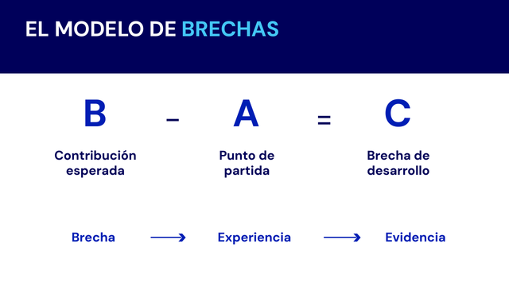

# 012 · El modelo de brechas

Montaje de rescates · pendiente de conciliación. Las propuestas fueron aprobadas; esta ficha no añade una aprobación humana del resultado.

## Voz en off literal

El modelo de brechas te ayuda a conectar el punto de partida de tu sucesor con la contribución que requerirá ocupar tu puesto. Llamaremos A a lo que sabe hacer hoy y a lo que ha demostrado en su puesto actual. B es el conjunto de habilidades que requerirá para las funciones y responsabilidades de tu puesto.

La diferencia entre B y A es C: la brecha de desarrollo. Para cubrirla, acordarás con tu sucesor un plan con acciones de aprendizaje, práctica y exposición a nuevas situaciones de liderazgo. Veamos cómo armar este plan paso a paso.

## Trazabilidad

| Campo | Valor |
|---|---|
| PPT exacta | `Sucesion_R13_Rescates_aprobados_PENDIENTE_CONCILIACION.pptx` |
| Versión | Montaje de 36 diapositivas realizado sobre R13 versión 6; no sustituye la R13 vigente |
| SHA-256 de la PPT | `73e337f32d15efca401fa11cb2111bce79a00f55f060b7a0baaf676c9634f32a` |
| Posición física en esta PPT | 012 |
| ID nativo | 267 |
| Estado original | Visible |
| PNG exacto | `R13_Rescates_aprobados_73e337f3__012.png` |
| SHA-256 del PNG publicado | `2e917a4bf72dfde36988e6510b30139942ffc4f3589d86b3f36cf06b19f1d113` |
| Dimensiones | 640 × 360 px, PNG RGB |
| Exportación | Render final de LibreOffice a 1280 × 720; reducción proporcional Lanczos3 a 640 × 360 con sharp 0.35.5, sin volver a renderizar la PPT |
| SHA-256 del render de producción | `f2ee1052d7f7072dc67fae4a4d6ed58b208ff0359de408b48b793fe8c4fb1012` |
| Voz | Literal de R13 versión 6; metadatos y notas de producción excluidos |
| SHA-256 de la voz UTF-8 | `f8a5308ee1446f8285a472024800f1d1e36be17d3c7e533e479b1a06eadc0c84` |
| Referencia del rescate | `NextGen_R12_experimento_visual_73_ENTREGA.pptx`, 73 diapositivas, posición 029, ID nativo 313 |
| SHA-256 de R12 | `7a69815752a0187f932c52349fe710e1d55c1190b393cd9cccf9a9c67b0da430` |
| Aprobación y publicación | Propuesta aprobada por Randy; imagen del montaje publicada para revisión, sin modificar R13 |

La miniatura de una variante anterior de R13 en esta posición fue retirada. **Imagen eliminada** para aquella variante: este PNG es una composición nueva, identificada por su PPT y huella, y no restaura el archivo retirado.

## Juicio visual de Sammy · criterio 080

**4 · Pulirla.** La ecuación domina con pesos y alineaciones claros, mientras las flechas inferiores muestran remates más duros que el resto del sistema gráfico.

Cambio mínimo propuesto, no ejecutado: Suavizar los remates de las flechas inferiores sin modificar la ecuación, sus etiquetas ni el recorrido.

La acción es el nombre de la escala, no una orden aplicada ni un veredicto nuevo de Randy. No se ha verificado una alternativa pública adicional en esta entrega.

## Juicio de locución de Sammy

Explicación en tuteo que da significado a A, B y C y complementa la fórmula visual, con la precaución oral de separar claramente la brecha del plan que ayudará a cubrirla.

Este juicio queda fuera del guion y no modifica la locución literal.

