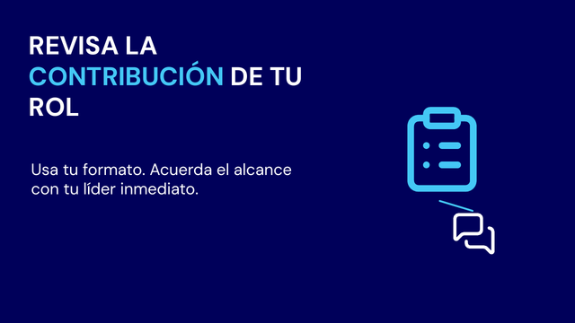

# 013 · Revisa la contribución de tu rol

Montaje de rescates · pendiente de conciliación. Las propuestas fueron aprobadas; esta ficha no añade una aprobación humana del resultado.

## Voz en off literal

Veamos con detalle el primer paso: contribución de tu rol.

En módulos anteriores de Soy Líder Tigo definimos nuestro modelo de contribución al puesto y lo trabajaste para los integrantes de tu equipo, analizando sus funciones y requisitos. En esta ocasión deberás revisar el formato de tu propio rol, acordándolo con tu líder inmediato.

## Trazabilidad

| Campo | Valor |
|---|---|
| PPT exacta | `Sucesion_R13_Rescates_aprobados_PENDIENTE_CONCILIACION.pptx` |
| Versión | Montaje de 36 diapositivas realizado sobre R13 versión 6; no sustituye la R13 vigente |
| SHA-256 de la PPT | `73e337f32d15efca401fa11cb2111bce79a00f55f060b7a0baaf676c9634f32a` |
| Posición física en esta PPT | 013 |
| ID nativo | 268 |
| Estado original | Visible |
| PNG exacto | `R13_Rescates_aprobados_73e337f3__013.png` |
| SHA-256 del PNG publicado | `d8d19e64d5b266df0a2414f2bbfb5b80cd3abb1b211dc9e120c0cd9fb773457e` |
| Dimensiones | 640 × 360 px, PNG RGB |
| Exportación | Render final de LibreOffice a 1280 × 720; reducción proporcional Lanczos3 a 640 × 360 con sharp 0.35.5, sin volver a renderizar la PPT |
| SHA-256 del render de producción | `9a799c965cd827ca104378a4524e0b411523180133f506803b848cf523627700` |
| Voz | Literal de R13 versión 6; metadatos y notas de producción excluidos |
| SHA-256 de la voz UTF-8 | `4f845671e496dcf9e46dc7ed4377124007c587ab9a63968d81d69034a8567476` |
| Referencia del rescate | `NextGen_R12_experimento_visual_73_ENTREGA.pptx`, 73 diapositivas, posición 010, ID nativo 294 |
| SHA-256 de R12 | `7a69815752a0187f932c52349fe710e1d55c1190b393cd9cccf9a9c67b0da430` |
| Aprobación y publicación | Propuesta aprobada por Randy; imagen del montaje publicada para revisión, sin modificar R13 |

La miniatura de una variante anterior de R13 en esta posición fue retirada. **Imagen eliminada** para aquella variante: este PNG es una composición nueva, identificada por su PPT y huella, y no restaura el archivo retirado.

## Juicio visual de Sammy · criterio 080

**4 · Pulirla.** El sistema de iconos y el contraste funcionan, pero la palabra «ROL» queda aislada en la última línea del titular.

Cambio mínimo propuesto, no ejecutado: Reequilibrar los saltos del titular sin cambiar una sola palabra.

La acción es el nombre de la escala, no una orden aplicada ni un veredicto nuevo de Randy. No se ha verificado una alternativa pública adicional en esta entrega.

## Juicio de locución de Sammy

Narración en tuteo que convierte la instrucción breve de pantalla en una tarea concreta y remite explícitamente al trabajo previo del modelo de contribución, por lo que conserva esa dependencia didáctica.

Este juicio queda fuera del guion y no modifica la locución literal.

