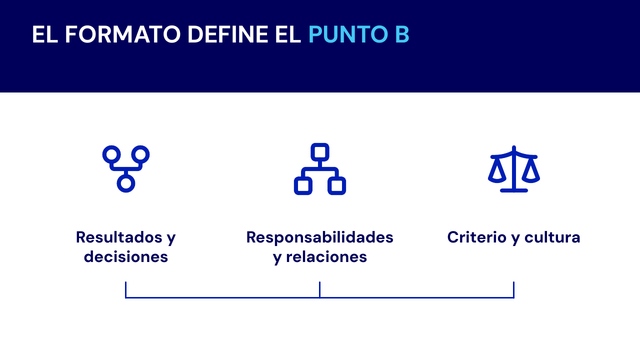

# 014 · El formato define el punto B

Montaje de rescates · pendiente de conciliación. Las propuestas fueron aprobadas; esta ficha no añade una aprobación humana del resultado.

## Voz en off literal

Redacta cómo se define tu aporte diario a la compañía y qué decisiones debes tomar en tu liderazgo. Muestra cómo se refleja en las acciones que tomas y en los resultados. Identifica las responsabilidades críticas, las áreas con las que se debe interactuar o las personas importantes con las que alguien de tu puesto debería relacionarse. La cultura también se refleja en cómo das reconocimiento o resuelves desacuerdos, así como en el trato a clientes internos o externos y la memoria histórica que te permite anticipar soluciones.

El resultado de tu formato debe permitir entender cómo funciona tu puesto para establecerlo como nuestro punto B en el análisis de brecha para las siguientes fases.

## Trazabilidad

| Campo | Valor |
|---|---|
| PPT exacta | `Sucesion_R13_Rescates_aprobados_PENDIENTE_CONCILIACION.pptx` |
| Versión | Montaje de 36 diapositivas realizado sobre R13 versión 6; no sustituye la R13 vigente |
| SHA-256 de la PPT | `73e337f32d15efca401fa11cb2111bce79a00f55f060b7a0baaf676c9634f32a` |
| Posición física en esta PPT | 014 |
| ID nativo | 269 |
| Estado original | Visible |
| PNG exacto | `R13_Rescates_aprobados_73e337f3__014.png` |
| SHA-256 del PNG publicado | `4c0a96d086063b8d38ca09e82dfde16200d73175fcdb164ba5deb74509acacf6` |
| Dimensiones | 640 × 360 px, PNG RGB |
| Exportación | Render final de LibreOffice a 1280 × 720; reducción proporcional Lanczos3 a 640 × 360 con sharp 0.35.5, sin volver a renderizar la PPT |
| SHA-256 del render de producción | `3c9a5544370a603a46bde7603fa24f384a55179363aed9ca345ad176c9112cd0` |
| Voz | Literal de R13 versión 6; metadatos y notas de producción excluidos |
| SHA-256 de la voz UTF-8 | `51379f0db7bcce3044079ff34fa466e5d447fa2333c8b09c4edc2718c99f7d10` |
| Referencia del rescate | `NextGen_R12_experimento_visual_73_ENTREGA.pptx`, 73 diapositivas, posición 054, ID nativo 264 |
| SHA-256 de R12 | `7a69815752a0187f932c52349fe710e1d55c1190b393cd9cccf9a9c67b0da430` |
| Aprobación y publicación | Propuesta aprobada por Randy; imagen del montaje publicada para revisión, sin modificar R13 |

La miniatura de una variante anterior de R13 en esta posición fue retirada. **Imagen eliminada** para aquella variante: este PNG es una composición nueva, identificada por su PPT y huella, y no restaura el archivo retirado.

## Juicio visual de Sammy · criterio 080

**4 · Pulirla.** La familia de símbolos y el corchete común forman un conjunto limpio, aunque las etiquetas de distinta altura dejan huecos desiguales sobre la línea inferior.

Cambio mínimo propuesto, no ejecutado: Igualar ópticamente la distancia entre cada etiqueta y el corchete sin alterar las categorías.

La acción es el nombre de la escala, no una orden aplicada ni un veredicto nuevo de Randy. No se ha verificado una alternativa pública adicional en esta entrega.

## Juicio de locución de Sammy

Instrucción en tuteo que desarrolla resultados, relaciones y cultura más allá de los rótulos, aunque su enumeración extensa requiere pausas entre esos ámbitos para no sonar como una lista continua.

Este juicio queda fuera del guion y no modifica la locución literal.

