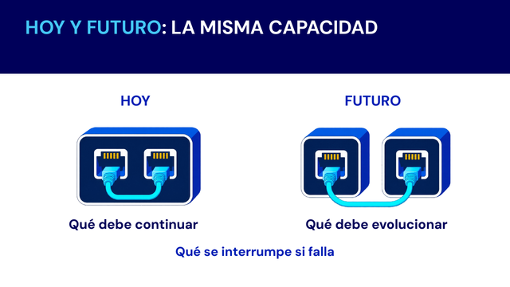

# 015 · Hoy y futuro: la misma capacidad

Montaje de rescates · pendiente de conciliación. Las propuestas fueron aprobadas; esta ficha no añade una aprobación humana del resultado.

## Voz en off literal

Al definir la contribución al puesto, reúne lo que sigue siendo importante y lo que necesitará evolucionar, considerando sus exigencias actuales y futuras. Describe las conductas que permitirán observar esas capacidades. En el formato de contribución, Hoy y Futuro deben hablar de la misma capacidad.

Para reconocer qué es crítico, pregunta qué se interrumpe y a quién afecta. A veces puedes simplificar una tarea o repartirla sin perder el resultado.

## Trazabilidad

| Campo | Valor |
|---|---|
| PPT exacta | `Sucesion_R13_Rescates_aprobados_PENDIENTE_CONCILIACION.pptx` |
| Versión | Montaje de 36 diapositivas realizado sobre R13 versión 6; no sustituye la R13 vigente |
| SHA-256 de la PPT | `73e337f32d15efca401fa11cb2111bce79a00f55f060b7a0baaf676c9634f32a` |
| Posición física en esta PPT | 015 |
| ID nativo | 270 |
| Estado original | Visible |
| PNG exacto | `R13_Rescates_aprobados_73e337f3__015.png` |
| SHA-256 del PNG publicado | `90b79ca908710bd36dccda813f4826bc75bc8b4139a96042dd1d0485e722ea23` |
| Dimensiones | 640 × 360 px, PNG RGB |
| Exportación | Render final de LibreOffice a 1280 × 720; reducción proporcional Lanczos3 a 640 × 360 con sharp 0.35.5, sin volver a renderizar la PPT |
| SHA-256 del render de producción | `668e7cb6398258f455c0b61d8d5b0a330ce9b1401605cdb4df2c5ae0607c2be6` |
| Voz | Literal de R13 versión 6; metadatos y notas de producción excluidos |
| SHA-256 de la voz UTF-8 | `945575e65ae1a52479f64477c50b692aebf775dfc9157d5fa5aa2db47db53dbf` |
| Referencia del rescate | `NextGen_R12_experimento_visual_73_ENTREGA.pptx`, 73 diapositivas, posición 051, ID nativo 263 |
| SHA-256 de R12 | `7a69815752a0187f932c52349fe710e1d55c1190b393cd9cccf9a9c67b0da430` |
| Aprobación y publicación | Propuesta aprobada por Randy; imagen del montaje publicada para revisión, sin modificar R13 |

La miniatura de una variante anterior de R13 en esta posición fue retirada. **Imagen eliminada** para aquella variante: este PNG es una composición nueva, identificada por su PPT y huella, y no restaura el archivo retirado.

## Juicio visual de Sammy · criterio 080

**5 · Aprobadísima.** Las dos conexiones se reconocen por su silueta y están separadas con aire suficiente, con rótulos grandes y un cierre inferior bien centrado.

Cambio mínimo propuesto, no ejecutado: Sin cambios.

La acción es el nombre de la escala, no una orden aplicada ni un veredicto nuevo de Randy. No se ha verificado una alternativa pública adicional en esta entrega.

## Juicio de locución de Sammy

Narración en tuteo que concreta cómo comparar hoy y futuro sobre una misma capacidad y añade la pregunta de criticidad que la pantalla solo anuncia.

Este juicio queda fuera del guion y no modifica la locución literal.

