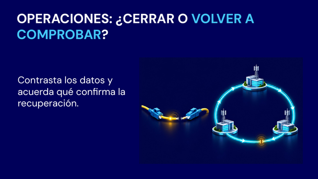

# 016 · Operaciones: ¿cerrar o volver a comprobar?

Montaje de rescates · pendiente de conciliación. Las propuestas fueron aprobadas; esta ficha no añade una aprobación humana del resultado.

Contexto de publicación: caso ficticio didáctico; no describe personas, valoraciones ni planes sucesorios reales.

## Voz en off literal

Veamos cómo se toman estas decisiones en dos casos ficticios.

A las ocho y diez, el tablero de Operaciones marcó el servicio como recuperado. Siete minutos después entró otra llamada por la misma falla. El reporte del equipo de red daba la incidencia por resuelta; Atención al Cliente seguía recibiendo llamadas. Javier Rojas, el líder de Operaciones, tenía que decidir si cerrar el caso o pedir otra revisión. Si él no estaba, ¿quién podía decidirlo?

En su formato, Javier anotó el resultado que debía sostener: restablecer el servicio para el cliente. Precisó la decisión que quería observar: cómo alguien contrasta datos que no coinciden y acuerda con las áreas cuándo cerrar una incidencia.

## Trazabilidad

| Campo | Valor |
|---|---|
| PPT exacta | `Sucesion_R13_Rescates_aprobados_PENDIENTE_CONCILIACION.pptx` |
| Versión | Montaje de 36 diapositivas realizado sobre R13 versión 6; no sustituye la R13 vigente |
| SHA-256 de la PPT | `73e337f32d15efca401fa11cb2111bce79a00f55f060b7a0baaf676c9634f32a` |
| Posición física en esta PPT | 016 |
| ID nativo | 271 |
| Estado original | Visible |
| PNG exacto | `R13_Rescates_aprobados_73e337f3__016.png` |
| SHA-256 del PNG publicado | `d6d2b802706db479788d03e0d91b65685751d36196da29ac9b7acddcb771bbc8` |
| Dimensiones | 640 × 360 px, PNG RGB |
| Exportación | Render final de LibreOffice a 1280 × 720; reducción proporcional Lanczos3 a 640 × 360 con sharp 0.35.5, sin volver a renderizar la PPT |
| SHA-256 del render de producción | `2a68ee1e2132ce0002b77876baf2373f782e0cb7d177391ba0710cebb7b56555` |
| Voz | Literal de R13 versión 6; metadatos y notas de producción excluidos |
| SHA-256 de la voz UTF-8 | `7728eb45f0310248f9c538b2baa571f42c440987502c38239ae50249da8e1c3c` |
| Referencia del rescate | `NextGen_R12_experimento_visual_73_ENTREGA.pptx`, 73 diapositivas, posición 015, ID nativo 299 |
| SHA-256 de R12 | `7a69815752a0187f932c52349fe710e1d55c1190b393cd9cccf9a9c67b0da430` |
| Aprobación y publicación | Propuesta aprobada por Randy; imagen del montaje publicada para revisión, sin modificar R13 |

## Juicio visual de Sammy · criterio 080

**3 · Afinarla.** Título y cuerpo conservan contraste y separación, pero el rectángulo opaco de la ilustración se distingue del fondo circundante como un bloque añadido.

Cambio mínimo propuesto, no ejecutado: Afinar la continuidad tonal entre el fondo nativo y el perímetro del arte, conservando la ilustración original opaca y sin intentar otra extracción.

La acción es el nombre de la escala, no una orden aplicada ni un veredicto nuevo de Randy. No se ha verificado una alternativa pública adicional en esta entrega.

## Juicio de locución de Sammy

Relato en tercera persona con una pregunta al oyente que hace comprensible el conflicto entre las señales de recuperación y declara desde el inicio que se trata de casos ficticios.

Este juicio queda fuera del guion y no modifica la locución literal.

