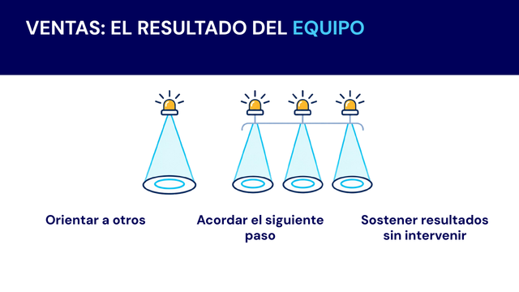

# 017 · Ventas: el resultado del equipo

Montaje de rescates · pendiente de conciliación. Las propuestas fueron aprobadas; esta ficha no añade una aprobación humana del resultado.

Contexto de publicación: caso ficticio didáctico; no describe personas, valoraciones ni planes sucesorios reales.

## Voz en off literal

Piensa en un vendedor que podría prepararse para liderar un equipo comercial como tú lo haces hoy. En este ejemplo, Juan atiende a sus clientes y cumple sus metas con alto desempeño. Sin embargo, eso no garantiza que esté preparado para orientar a otros vendedores, analizar indicadores globales, definir metas y darles seguimiento, respondiendo por los resultados del conjunto. Este tipo de cambios te ayudará a especificar lo que necesita aprender tu sucesor.

En Ventas, Ricardo Méndez encontró una pista. Dos vendedores habían recuperado oportunidades que llevaban días detenidas. En ambas notas aparecía la misma pregunta: «¿Qué necesita confirmar el cliente para decidir?». Ricardo pensó que la pregunta venía de Juan Herrera. La prueba para Ricardo sería que el equipo pudiera avanzar también cuando esa persona no estuviera en la llamada.

## Trazabilidad

| Campo | Valor |
|---|---|
| PPT exacta | `Sucesion_R13_Rescates_aprobados_PENDIENTE_CONCILIACION.pptx` |
| Versión | Montaje de 36 diapositivas realizado sobre R13 versión 6; no sustituye la R13 vigente |
| SHA-256 de la PPT | `73e337f32d15efca401fa11cb2111bce79a00f55f060b7a0baaf676c9634f32a` |
| Posición física en esta PPT | 017 |
| ID nativo | 272 |
| Estado original | Visible |
| PNG exacto | `R13_Rescates_aprobados_73e337f3__017.png` |
| SHA-256 del PNG publicado | `ad2fc7fb019adeff974ce8b9673e18bdc4a04ef71123f52ceedd75bfba49f3b4` |
| Dimensiones | 640 × 360 px, PNG RGB |
| Exportación | Render final de LibreOffice a 1280 × 720; reducción proporcional Lanczos3 a 640 × 360 con sharp 0.35.5, sin volver a renderizar la PPT |
| SHA-256 del render de producción | `6ac4944d6f7e6dbc28b44dfb9ebe1ee5cf79ca6ca62bec245478b7f1ec54b671` |
| Voz | Literal de R13 versión 6; metadatos y notas de producción excluidos |
| SHA-256 de la voz UTF-8 | `6515857b9a3e0e08d786642b81326474906c347f661cddb7db65625339cd369c` |
| Referencia del rescate | `NextGen_R12_experimento_visual_73_ENTREGA.pptx`, 73 diapositivas, posición 017, ID nativo 301 |
| SHA-256 de R12 | `7a69815752a0187f932c52349fe710e1d55c1190b393cd9cccf9a9c67b0da430` |
| Aprobación y publicación | Propuesta aprobada por Randy; imagen del montaje publicada para revisión, sin modificar R13 |

La miniatura de una variante anterior de R13 en esta posición fue retirada. **Imagen eliminada** para aquella variante: este PNG es una composición nueva, identificada por su PPT y huella, y no restaura el archivo retirado.

## Juicio visual de Sammy · criterio 080

**4 · Pulirla.** Las lámparas tienen un trazo homogéneo y legible, pero el grupo visual queda más concentrado en el centro que la fila de tres etiquetas.

Cambio mínimo propuesto, no ejecutado: Ajustar el ancho y la alineación óptica de la fila de etiquetas al conjunto de lámparas, conservando su contraste individual/colectivo.

La acción es el nombre de la escala, no una orden aplicada ni un veredicto nuevo de Randy. No se ha verificado una alternativa pública adicional en esta entrega.

## Juicio de locución de Sammy

Alterna una invitación inicial en tuteo con narración en tercera persona para explicar la diferencia entre vender bien y sostener el resultado del equipo, manteniendo a los personajes dentro del caso ficticio.

Este juicio queda fuera del guion y no modifica la locución literal.

