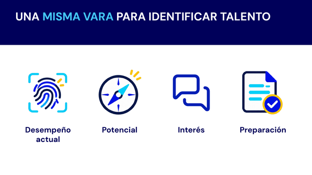

# 018 · Una misma vara para identificar talento

Montaje de rescates · pendiente de conciliación. Las propuestas fueron aprobadas; esta ficha no añade una aprobación humana del resultado.

## Voz en off literal

El segundo momento es la identificación de talento. William Rothwell advierte: «Evaluar el potencial futuro no debe confundirse con evaluar el desempeño en el puesto actual».

En tu matriz, usa la misma exigencia para comparar qué hizo cada persona y con cuánto apoyo. Parte de la contribución adecuada en el puesto actual. Observa el compromiso en los acuerdos que cumple y el potencial en cómo aprende ante un reto nuevo. Comprueba por separado el interés por el rol y qué responsabilidades ya puede sostener. Si no hubo ocasión de observar una habilidad, déjala pendiente. No conviertas una oportunidad que nunca diste en una debilidad.

## Trazabilidad

| Campo | Valor |
|---|---|
| PPT exacta | `Sucesion_R13_Rescates_aprobados_PENDIENTE_CONCILIACION.pptx` |
| Versión | Montaje de 36 diapositivas realizado sobre R13 versión 6; no sustituye la R13 vigente |
| SHA-256 de la PPT | `73e337f32d15efca401fa11cb2111bce79a00f55f060b7a0baaf676c9634f32a` |
| Posición física en esta PPT | 018 |
| ID nativo | 273 |
| Estado original | Visible |
| PNG exacto | `R13_Rescates_aprobados_73e337f3__018.png` |
| SHA-256 del PNG publicado | `6721c4f1209bb5b0583b2855befa6c7df384c34950b2ea48f307a57bcec3933e` |
| Dimensiones | 640 × 360 px, PNG RGB |
| Exportación | Render final de LibreOffice a 1280 × 720; reducción proporcional Lanczos3 a 640 × 360 con sharp 0.35.5, sin volver a renderizar la PPT |
| SHA-256 del render de producción | `d7a2759df9048678c17aecf6baf9bef6e278d9c49a9f1a1b8be36ddd36cd529b` |
| Voz | Literal de R13 versión 6; metadatos y notas de producción excluidos |
| SHA-256 de la voz UTF-8 | `3bd4f0974bdc928502f30c378e47dfc1a1154a1483499f86e165e020f1c35933` |
| Referencia del rescate | `NextGen_R12_experimento_visual_73_ENTREGA.pptx`, 73 diapositivas, posición 019, ID nativo 303 |
| SHA-256 de R12 | `7a69815752a0187f932c52349fe710e1d55c1190b393cd9cccf9a9c67b0da430` |
| Aprobación y publicación | Propuesta aprobada por Randy; imagen del montaje publicada para revisión, sin modificar R13 |

## Juicio visual de Sammy · criterio 080

**4 · Pulirla.** Los cuatro símbolos tienen siluetas claras y contraste alto, aunque la etiqueta de dos líneas deja una base visual distinta a las otras tres.

Cambio mínimo propuesto, no ejecutado: Equilibrar la altura óptica de las cuatro etiquetas, conservando los elementos rescatados de R12 019 y sus colores.

La acción es el nombre de la escala, no una orden aplicada ni un veredicto nuevo de Randy. No se ha verificado una alternativa pública adicional en esta entrega.

## Juicio de locución de Sammy

Narración que abre con una cita atribuida y luego pasa al tuteo para distinguir los cuatro criterios, con una enumeración que conviene pronunciar por bloques para no confundir desempeño, potencial, interés y preparación.

Este juicio queda fuera del guion y no modifica la locución literal.

