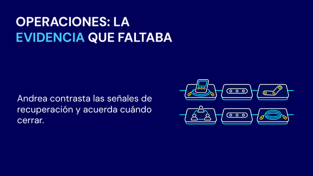

# 019 · Operaciones: la evidencia que faltaba

Montaje de rescates · pendiente de conciliación. Las propuestas fueron aprobadas; esta ficha no añade una aprobación humana del resultado.

Contexto de publicación: caso ficticio didáctico; no describe personas, valoraciones ni planes sucesorios reales.

## Voz en off literal

En Operaciones, Carlos Vega encontró rápido la falla original. Mariana Pineda explicó cómo atenderla sin dejar el turno sin respaldo. Bruno Salcedo también propuso una solución técnicamente sólida. A Andrea López, ingeniera, Javier solía pedirle que preparara los datos para que alguien más presentara la recomendación. Así apenas había visto lo que ella podía decidir.

Andrea le preguntó: «¿Estamos cerrando la alarma o comprobando que el servicio volvió para el cliente?». Mostró que las áreas usaban dos horas distintas como señal de recuperación. Les pidió contrastar los registros y acordó con ellas qué debían comprobar antes de cerrar. Andrea ya había hecho algo parecido en otro turno. La decisión no figuraba a su nombre. Javier preguntó a quienes participaron qué había resuelto ella.

## Trazabilidad

| Campo | Valor |
|---|---|
| PPT exacta | `Sucesion_R13_Rescates_aprobados_PENDIENTE_CONCILIACION.pptx` |
| Versión | Montaje de 36 diapositivas realizado sobre R13 versión 6; no sustituye la R13 vigente |
| SHA-256 de la PPT | `73e337f32d15efca401fa11cb2111bce79a00f55f060b7a0baaf676c9634f32a` |
| Posición física en esta PPT | 019 |
| ID nativo | 274 |
| Estado original | Visible |
| PNG exacto | `R13_Rescates_aprobados_73e337f3__019.png` |
| SHA-256 del PNG publicado | `91b70b87e8070aedaa7d8daf6af2bea2c98a0392a51a1e80089d56fc516c797a` |
| Dimensiones | 640 × 360 px, PNG RGB |
| Exportación | Render final de LibreOffice a 1280 × 720; reducción proporcional Lanczos3 a 640 × 360 con sharp 0.35.5, sin volver a renderizar la PPT |
| SHA-256 del render de producción | `932ce7036bf4306af8ca18a981438dc4b777e8ab261bae71358578692cdd1748` |
| Voz | Literal de R13 versión 6; metadatos y notas de producción excluidos |
| SHA-256 de la voz UTF-8 | `2e290fa7b0b811bd51114505387ca2b801af008dc7ed9bf337d84c5e72dbfbd4` |
| Referencia del rescate | `NextGen_R12_experimento_visual_73_ENTREGA.pptx`, 73 diapositivas, posición 023, ID nativo 307 |
| SHA-256 de R12 | `7a69815752a0187f932c52349fe710e1d55c1190b393cd9cccf9a9c67b0da430` |
| Aprobación y publicación | Propuesta aprobada por Randy; imagen del montaje publicada para revisión, sin modificar R13 |

## Juicio visual de Sammy · criterio 080

**3 · Afinarla.** El título y la ilustración se integran en el fondo, pero las seis plataformas conservan detalles pequeños y finos frente al peso del bloque textual.

Cambio mínimo propuesto, no ejecutado: Redistribuir el ancho entre texto y arte para ampliar las plataformas sin modificar sus elementos ni el texto.

La acción es el nombre de la escala, no una orden aplicada ni un veredicto nuevo de Randy. No se ha verificado una alternativa pública adicional en esta entrega.

## Juicio de locución de Sammy

Narración en tercera persona con una intervención directa de Andrea que muestra la evidencia faltante detrás de la pantalla y requiere conservar claro el contexto ficticio al publicarse por separado.

Este juicio queda fuera del guion y no modifica la locución literal.

