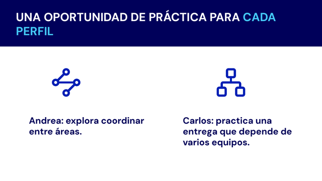

# 021 · Una oportunidad de práctica para cada perfil

Montaje de rescates · pendiente de conciliación. Las propuestas fueron aprobadas; esta ficha no añade una aprobación humana del resultado.

Contexto de publicación: caso ficticio didáctico; no describe personas, valoraciones ni planes sucesorios reales.

## Voz en off literal

Andrea sí quería explorar la coordinación entre áreas. Javier dejó en su plan reservado que la prepararía para una posible sucesión. Con ella acordó qué responsabilidad practicar. Carlos conservó una oportunidad de desarrollo: coordinar una entrega que dependiera de más de un equipo.

## Trazabilidad

| Campo | Valor |
|---|---|
| PPT exacta | `Sucesion_R13_Rescates_aprobados_PENDIENTE_CONCILIACION.pptx` |
| Versión | Montaje de 36 diapositivas realizado sobre R13 versión 6; no sustituye la R13 vigente |
| SHA-256 de la PPT | `73e337f32d15efca401fa11cb2111bce79a00f55f060b7a0baaf676c9634f32a` |
| Posición física en esta PPT | 021 |
| ID nativo | 276 |
| Estado original | Visible |
| PNG exacto | `R13_Rescates_aprobados_73e337f3__021.png` |
| SHA-256 del PNG publicado | `915dfec82f27a191f37fb611a954cba8feb98feb9610ffc2feb71dfc48820cb5` |
| Dimensiones | 640 × 360 px, PNG RGB |
| Exportación | Render final de LibreOffice a 1280 × 720; reducción proporcional Lanczos3 a 640 × 360 con sharp 0.35.5, sin volver a renderizar la PPT |
| SHA-256 del render de producción | `2aa0f81320fe54c01f4855d9ba4457b3d35de561d3bf399b7c86ac79c17e778a` |
| Voz | Literal de R13 versión 6; metadatos y notas de producción excluidos |
| SHA-256 de la voz UTF-8 | `11f146889d0c42948cec53fa8010d23e73588224c32b1f307abcd5df037dd9a5` |
| Referencia del rescate | `NextGen_R12_experimento_visual_73_ENTREGA.pptx`, 73 diapositivas, posición 022, ID nativo 306 |
| SHA-256 de R12 | `7a69815752a0187f932c52349fe710e1d55c1190b393cd9cccf9a9c67b0da430` |
| Aprobación y publicación | Propuesta aprobada por Randy; imagen del montaje publicada para revisión, sin modificar R13 |

La miniatura de una variante anterior de R13 en esta posición fue retirada. **Imagen eliminada** para aquella variante: este PNG es una composición nueva, identificada por su PPT y huella, y no restaura el archivo retirado.

## Juicio visual de Sammy · criterio 080

**3 · Afinarla.** La pareja de iconos mantiene una familia coherente, pero la separación amplia entre símbolos y textos y el mayor peso del bloque derecho debilitan el equilibrio de la comparación.

Cambio mínimo propuesto, no ejecutado: Compactar la separación icono–texto y equilibrar ópticamente los dos bloques, conservando sus textos.

La acción es el nombre de la escala, no una orden aplicada ni un veredicto nuevo de Randy. No se ha verificado una alternativa pública adicional en esta entrega.

## Juicio de locución de Sammy

Relato breve en tercera persona que distingue la práctica acordada del plan reservado del líder, por lo que la publicación individual debe identificar el caso como ficticio fuera del bloque de voz.

Este juicio queda fuera del guion y no modifica la locución literal.

