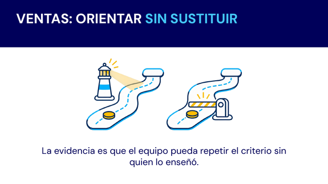

# 022 · Ventas: orientar sin sustituir

Montaje de rescates · pendiente de conciliación. Las propuestas fueron aprobadas; esta ficha no añade una aprobación humana del resultado.

Contexto de publicación: caso ficticio didáctico; no describe personas, valoraciones ni planes sucesorios reales.

## Voz en off literal

En Ventas, Ricardo observó prácticas comparables. Juan hizo buenas preguntas en el ensayo, pero, cuando el cliente dudó, tomó la palabra y cerró la venta. Al día siguiente su compañero volvió a quedarse atascado. Olga Fuentes detectó en qué parte del seguimiento se perdían las oportunidades. Aún faltaba ver si podía ayudar al equipo a corregirlo. Valeria Paz ya ayudaba a sus colegas a prepararse; en su conversación con Ricardo explicó que le interesaba otra función comercial.

La pista llevó a Tomás Calderón, que no destacaba por sus cifras individuales. Había ensayado la pregunta con una vendedora y la dejó conducir la llamada. Después le preguntó qué le había funcionado. Ella enseñó el criterio a otro vendedor. Ricardo comprobó que ambos sabían cuándo usarlo. Después confirmó que a Tomás le interesaba liderar y anotó en su plan reservado que lo prepararía. Juan, por su parte, acordó seguir practicando cómo orientar sin intervenir en el cierre.

## Trazabilidad

| Campo | Valor |
|---|---|
| PPT exacta | `Sucesion_R13_Rescates_aprobados_PENDIENTE_CONCILIACION.pptx` |
| Versión | Montaje de 36 diapositivas realizado sobre R13 versión 6; no sustituye la R13 vigente |
| SHA-256 de la PPT | `73e337f32d15efca401fa11cb2111bce79a00f55f060b7a0baaf676c9634f32a` |
| Posición física en esta PPT | 022 |
| ID nativo | 277 |
| Estado original | Visible |
| PNG exacto | `R13_Rescates_aprobados_73e337f3__022.png` |
| SHA-256 del PNG publicado | `1e9218efb094205229fb18ac5327c0c6b8d0fd6a451fff12486674470632fae7` |
| Dimensiones | 640 × 360 px, PNG RGB |
| Exportación | Render final de LibreOffice a 1280 × 720; reducción proporcional Lanczos3 a 640 × 360 con sharp 0.35.5, sin volver a renderizar la PPT |
| SHA-256 del render de producción | `621eafbc3bbb8e970777517d129fa54af7c4ebbfe06810e718509ebbdba20d5c` |
| Voz | Literal de R13 versión 6; metadatos y notas de producción excluidos |
| SHA-256 de la voz UTF-8 | `e9be6ce74f2561b716848225267671f630f6a3ca15b8414e8ed074b0ca26d030` |
| Referencia del rescate | `NextGen_R12_experimento_visual_73_ENTREGA.pptx`, 73 diapositivas, posición 024, ID nativo 308 |
| SHA-256 de R12 | `7a69815752a0187f932c52349fe710e1d55c1190b393cd9cccf9a9c67b0da430` |
| Aprobación y publicación | Propuesta aprobada por Randy; imagen del montaje publicada para revisión, sin modificar R13 |

## Juicio visual de Sammy · criterio 080

**5 · Aprobadísima.** Las dos rutas forman una silueta central reconocible, con escala suficiente, trazo coherente y una separación limpia entre titular, ilustración y frase inferior.

Cambio mínimo propuesto, no ejecutado: Sin cambios.

La acción es el nombre de la escala, no una orden aplicada ni un veredicto nuevo de Randy. No se ha verificado una alternativa pública adicional en esta entrega.

## Juicio de locución de Sammy

Narración en tercera persona que aporta las pruebas concretas de orientar sin sustituir, aunque la sucesión de perfiles y nombres exige pausas claras y el plan reservado debe entenderse dentro de la ficción didáctica.

Este juicio queda fuera del guion y no modifica la locución literal.

