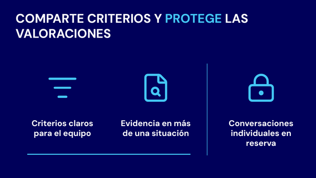

# 023 · Comparte criterios y protege las valoraciones

Montaje de rescates · pendiente de conciliación. Las propuestas fueron aprobadas; esta ficha no añade una aprobación humana del resultado.

## Voz en off literal

Puedes explicar al equipo qué exige un puesto y qué evidencias contarían en una evaluación. Una fortaleza visible no demuestra otra habilidad. Un error tampoco invalida todas las demás evidencias. Contrasta lo observado en más de una situación. Mantén en reserva las valoraciones y la identidad de quienes consideras. Conversa con cada persona sobre su progreso, sin anunciarle que figura como posible sucesora. Si vas a comunicar algo sobre el programa, comparte con cada audiencia solo lo que necesita saber.

## Trazabilidad

| Campo | Valor |
|---|---|
| PPT exacta | `Sucesion_R13_Rescates_aprobados_PENDIENTE_CONCILIACION.pptx` |
| Versión | Montaje de 36 diapositivas realizado sobre R13 versión 6; no sustituye la R13 vigente |
| SHA-256 de la PPT | `73e337f32d15efca401fa11cb2111bce79a00f55f060b7a0baaf676c9634f32a` |
| Posición física en esta PPT | 023 |
| ID nativo | 278 |
| Estado original | Visible |
| PNG exacto | `R13_Rescates_aprobados_73e337f3__023.png` |
| SHA-256 del PNG publicado | `c56ac43db8f06d4fe202ac8a97a5c76442cdb024a11f2f8cdf94036bbccbc21e` |
| Dimensiones | 640 × 360 px, PNG RGB |
| Exportación | Render final de LibreOffice a 1280 × 720; reducción proporcional Lanczos3 a 640 × 360 con sharp 0.35.5, sin volver a renderizar la PPT |
| SHA-256 del render de producción | `5a06ca5f45b8c2ffec02d56e81ddfedc1f70e556f86d1113618f2fc7c8bfa8d5` |
| Voz | Literal de R13 versión 6; metadatos y notas de producción excluidos |
| SHA-256 de la voz UTF-8 | `dc58ea36806a962c443644352ee978a77b6b3e683abc95949d361686b5b3ee49` |
| Referencia del rescate | `NextGen_R12_experimento_visual_73_ENTREGA.pptx`, 73 diapositivas, posición 020, ID nativo 304 |
| SHA-256 de R12 | `7a69815752a0187f932c52349fe710e1d55c1190b393cd9cccf9a9c67b0da430` |
| Aprobación y publicación | Propuesta aprobada por Randy; imagen del montaje publicada para revisión, sin modificar R13 |

La miniatura de una variante anterior de R13 en esta posición fue retirada. **Imagen eliminada** para aquella variante: este PNG es una composición nueva, identificada por su PPT y huella, y no restaura el archivo retirado.

## Juicio visual de Sammy · criterio 080

**4 · Pulirla.** El titular y los tres símbolos cian sostienen una composición coherente, mientras la base compartida y la separación lateral distinguen visualmente dos grupos sin recurrir a tarjetas.

Cambio mínimo propuesto, no ejecutado: Ajustar el ancho y la distribución del bloque derecho para acercar su peso óptico al de los otros dos, sin cambiar las palabras.

La acción es el nombre de la escala, no una orden aplicada ni un veredicto nuevo de Randy. No se ha verificado una alternativa pública adicional en esta entrega.

## Juicio de locución de Sammy

Orientación directa en tuteo que complementa los dos ámbitos visuales y permite enfatizar la diferencia entre compartir criterios y mantener reservadas las valoraciones individuales.

Este juicio queda fuera del guion y no modifica la locución literal.

