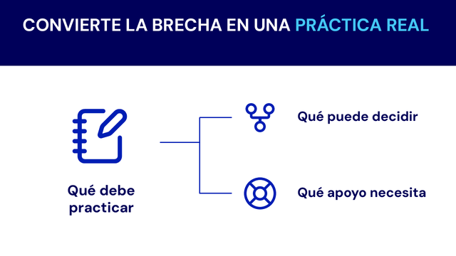

# 024 · Convierte la brecha en una práctica real

Montaje de rescates · pendiente de conciliación. Las propuestas fueron aprobadas; esta ficha no añade una aprobación humana del resultado.

## Voz en off literal

El tercer momento es el desarrollo de habilidades. En el Plan de Desarrollo Individual, o PDI, convierte la brecha en una práctica real y acotada. Acuerda qué podrá decidir la persona, qué apoyo tendrá, qué evidencia revisarás y cuándo.

Por ejemplo, puede necesitar fortalecer su conocimiento del negocio, participar en decisiones y negociaciones, o relacionarse con otras áreas. Definan juntos qué evidencias mostrarán su avance y asume tu rol como mentor durante el proceso. Explica el porqué de tus decisiones, escucha sus dudas y enséñale los criterios que te han ayudado a tomar decisiones exitosas.

## Trazabilidad

| Campo | Valor |
|---|---|
| PPT exacta | `Sucesion_R13_Rescates_aprobados_PENDIENTE_CONCILIACION.pptx` |
| Versión | Montaje de 36 diapositivas realizado sobre R13 versión 6; no sustituye la R13 vigente |
| SHA-256 de la PPT | `73e337f32d15efca401fa11cb2111bce79a00f55f060b7a0baaf676c9634f32a` |
| Posición física en esta PPT | 024 |
| ID nativo | 279 |
| Estado original | Visible |
| PNG exacto | `R13_Rescates_aprobados_73e337f3__024.png` |
| SHA-256 del PNG publicado | `cb82be0b0c8e5d9b89d3aff0faff625ffa167e1249afc6cf04685d6746d68257` |
| Dimensiones | 640 × 360 px, PNG RGB |
| Exportación | Render final de LibreOffice a 1280 × 720; reducción proporcional Lanczos3 a 640 × 360 con sharp 0.35.5, sin volver a renderizar la PPT |
| SHA-256 del render de producción | `0550ebfd36fcd3005047a880564720a9bee6dcaa2969ebd665fb1325ed3bc5f0` |
| Voz | Literal de R13 versión 6; metadatos y notas de producción excluidos |
| SHA-256 de la voz UTF-8 | `09c9621ee3ecf97c0fc99b4ebfe9ef49d87e4abb5135bbeb19ff16ce916b52e7` |
| Referencia del rescate | `NextGen_R12_experimento_visual_73_ENTREGA.pptx`, 73 diapositivas, posición 029, ID nativo 313 |
| SHA-256 de R12 | `7a69815752a0187f932c52349fe710e1d55c1190b393cd9cccf9a9c67b0da430` |
| Aprobación y publicación | Propuesta aprobada por Randy; imagen del montaje publicada para revisión, sin modificar R13 |

## Juicio visual de Sammy · criterio 080

**3 · Afinarla.** La ramificación crea un diagrama reconocible, pero los conectores finos y angulosos contrastan con el grosor y los remates redondeados de los iconos.

Cambio mínimo propuesto, no ejecutado: Redondear los codos y armonizar el grosor de los conectores con la familia de símbolos.

La acción es el nombre de la escala, no una orden aplicada ni un veredicto nuevo de Randy. No se ha verificado una alternativa pública adicional en esta entrega.

## Juicio de locución de Sammy

Narración en tuteo que desarrolla el nombre completo del PDI y explica cómo decisión, apoyo y evidencia delimitan la práctica representada en pantalla.

Este juicio queda fuera del guion y no modifica la locución literal.

