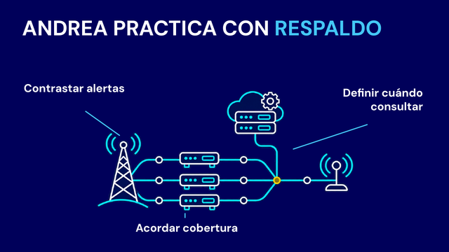

# 026 · Andrea practica con respaldo

Montaje de rescates · pendiente de conciliación. Las propuestas fueron aprobadas; esta ficha no añade una aprobación humana del resultado.

Contexto de publicación: caso ficticio didáctico; no describe personas, valoraciones ni planes sucesorios reales.

## Voz en off literal

En Operaciones llegó un tablero de alertas que agrupaba señales de distintas zonas. Andrea ya sabía contrastar datos y acordar prioridades entre áreas. Esas eran habilidades transferibles: también le servían con la tecnología nueva. En el primer ensayo dio por relacionadas dos señales que venían de zonas distintas. Mariana detectó el error. Antes de otra práctica, Andrea necesitaba aprender a comprobar qué alertas correspondían a un mismo incidente.

Andrea verificaría las alertas con un especialista antes de conducir una incidencia acotada. Javier contaba con Mariana para cubrirla, pero a esa hora ella ya tenía otro turno a cargo. El mismo nombre figuraba para dos trabajos que no podía atender a la vez. Javier reorganizó la cobertura. «Antes de cerrar, dime cómo queda el acuerdo», le pidió. Andrea respondió: «Yo preparo dos opciones y conduzco la coordinación. Tú confirmas el apoyo y liberas el tiempo. Si hace falta un cambio que pueda afectar el servicio, te consulto antes».

## Trazabilidad

| Campo | Valor |
|---|---|
| PPT exacta | `Sucesion_R13_Rescates_aprobados_PENDIENTE_CONCILIACION.pptx` |
| Versión | Montaje de 36 diapositivas realizado sobre R13 versión 6; no sustituye la R13 vigente |
| SHA-256 de la PPT | `73e337f32d15efca401fa11cb2111bce79a00f55f060b7a0baaf676c9634f32a` |
| Posición física en esta PPT | 026 |
| ID nativo | 281 |
| Estado original | Visible |
| PNG exacto | `R13_Rescates_aprobados_73e337f3__026.png` |
| SHA-256 del PNG publicado | `1692b362e6fb6e4fbdb8aab61d1f6760062b10d6e2793e3543329f64117c5fbf` |
| Dimensiones | 640 × 360 px, PNG RGB |
| Exportación | Render final de LibreOffice a 1280 × 720; reducción proporcional Lanczos3 a 640 × 360 con sharp 0.35.5, sin volver a renderizar la PPT |
| SHA-256 del render de producción | `47524c8df2da186b7108a745e9a28fec18e4a917de1d747c35b351cf81b30fcc` |
| Voz | Literal de R13 versión 6; metadatos y notas de producción excluidos |
| SHA-256 de la voz UTF-8 | `a2d4e7be8d4e72c1d0fd0f1f700ec58aaba65b0755782456a9e97f4e1586f5d0` |
| Referencia del rescate | `NextGen_R12_experimento_visual_73_ENTREGA.pptx`, 73 diapositivas, posición 030, ID nativo 314 |
| SHA-256 de R12 | `7a69815752a0187f932c52349fe710e1d55c1190b393cd9cccf9a9c67b0da430` |
| Aprobación y publicación | Propuesta aprobada por Randy; imagen del montaje publicada para revisión, sin modificar R13 |

La miniatura de una variante anterior de R13 en esta posición fue retirada. **Imagen eliminada** para aquella variante: este PNG es una composición nueva, identificada por su PPT y huella, y no restaura el archivo retirado.

## Juicio visual de Sammy · criterio 080

**4 · Pulirla.** La red ampliada domina con una silueta reconocible y buen contraste, pero los tres trazos de llamada tienen longitudes y puntos de llegada visualmente dispares.

Cambio mínimo propuesto, no ejecutado: Afinar las terminaciones de los trazos de llamada y su distancia a los nodos, sin cambiar la red ni las etiquetas.

La acción es el nombre de la escala, no una orden aplicada ni un veredicto nuevo de Randy. No se ha verificado una alternativa pública adicional en esta entrega.

## Juicio de locución de Sammy

Combina narración en tercera persona con réplicas directas de Javier y Andrea para explicar la cobertura y los límites de consulta, por lo que al locutar debe distinguirse quién habla sin añadir indicaciones al guion.

Este juicio queda fuera del guion y no modifica la locución literal.

