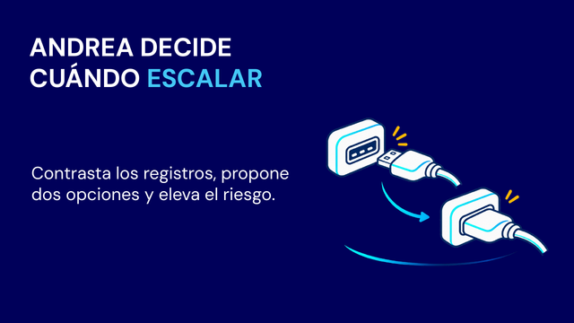

# 027 · Andrea decide cuándo escalar

Montaje de rescates · pendiente de conciliación. Las propuestas fueron aprobadas; esta ficha no añade una aprobación humana del resultado.

Contexto de publicación: caso ficticio didáctico; no describe personas, valoraciones ni planes sucesorios reales.

## Voz en off literal

En la siguiente incidencia, Andrea contrastó el tablero con el registro y pidió verificar las llamadas. Una intervención podía afectar otra zona: presentó dos opciones y elevó la decisión. Javier la dejó conducir. Si él hubiera resuelto el problema desde el principio, no habría visto que Andrea sabía cuándo escalar.

## Trazabilidad

| Campo | Valor |
|---|---|
| PPT exacta | `Sucesion_R13_Rescates_aprobados_PENDIENTE_CONCILIACION.pptx` |
| Versión | Montaje de 36 diapositivas realizado sobre R13 versión 6; no sustituye la R13 vigente |
| SHA-256 de la PPT | `73e337f32d15efca401fa11cb2111bce79a00f55f060b7a0baaf676c9634f32a` |
| Posición física en esta PPT | 027 |
| ID nativo | 282 |
| Estado original | Visible |
| PNG exacto | `R13_Rescates_aprobados_73e337f3__027.png` |
| SHA-256 del PNG publicado | `0aa28c72ba66fc9faf2caaf99a10526f4f9bd390785f3812651cd80b4cdcaf6f` |
| Dimensiones | 640 × 360 px, PNG RGB |
| Exportación | Render final de LibreOffice a 1280 × 720; reducción proporcional Lanczos3 a 640 × 360 con sharp 0.35.5, sin volver a renderizar la PPT |
| SHA-256 del render de producción | `7e04dfe4a5027d2ebcc2acb516ce4258ed0cf3907666b3d65962cf469353d8f8` |
| Voz | Literal de R13 versión 6; metadatos y notas de producción excluidos |
| SHA-256 de la voz UTF-8 | `56cd88c04aa05e6af46c57e0c6ba620bcec23b3a7498c754345d7f9656c11b4e` |
| Referencia del rescate | `NextGen_R12_experimento_visual_73_ENTREGA.pptx`, 73 diapositivas, posición 031, ID nativo 315 |
| SHA-256 de R12 | `7a69815752a0187f932c52349fe710e1d55c1190b393cd9cccf9a9c67b0da430` |
| Aprobación y publicación | Propuesta aprobada por Randy; imagen del montaje publicada para revisión, sin modificar R13 |

La miniatura de una variante anterior de R13 en esta posición fue retirada. **Imagen eliminada** para aquella variante: este PNG es una composición nueva, identificada por su PPT y huella, y no restaura el archivo retirado.

## Juicio visual de Sammy · criterio 080

**4 · Pulirla.** El bloque tipográfico y la ilustración diagonal de conectores tienen carácter y contraste, aunque el amplio salto vertical entre título y frase dispersa el foco izquierdo.

Cambio mínimo propuesto, no ejecutado: Acercar ligeramente la frase al titular para compactar el bloque izquierdo, conservando la ilustración.

La acción es el nombre de la escala, no una orden aplicada ni un veredicto nuevo de Randy. No se ha verificado una alternativa pública adicional en esta entrega.

## Juicio de locución de Sammy

Narración breve en tercera persona que muestra por qué elevar un riesgo puede ser evidencia de criterio y complementa la pantalla sin afirmar autonomía más allá de la situación observada.

Este juicio queda fuera del guion y no modifica la locución literal.

