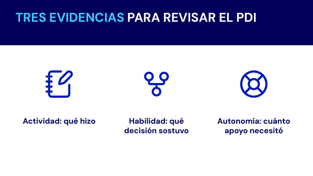

# 029 · Tres evidencias para revisar el PDI

Montaje de rescates · pendiente de conciliación. Las propuestas fueron aprobadas; esta ficha no añade una aprobación humana del resultado.

## Voz en off literal

Al revisar el PDI, separa tres evidencias. La actividad dice qué hizo la persona. La habilidad aparece en la decisión que pudo explicar y sostener. La autonomía se ve en cuánto apoyo necesitó y si puede actuar con menos en otra situación. Si la práctica no ocurrió porque faltó acceso, tiempo o autoridad, corrige esa condición antes de evaluar la habilidad. Si tuvo lo necesario y le costó entender posiciones distintas, practica con ella cómo explorar el desacuerdo y construir alternativas.

## Trazabilidad

| Campo | Valor |
|---|---|
| PPT exacta | `Sucesion_R13_Rescates_aprobados_PENDIENTE_CONCILIACION.pptx` |
| Versión | Montaje de 36 diapositivas realizado sobre R13 versión 6; no sustituye la R13 vigente |
| SHA-256 de la PPT | `73e337f32d15efca401fa11cb2111bce79a00f55f060b7a0baaf676c9634f32a` |
| Posición física en esta PPT | 029 |
| ID nativo | 284 |
| Estado original | Visible |
| PNG exacto | `R13_Rescates_aprobados_73e337f3__029.png` |
| SHA-256 del PNG publicado | `863a04ff394028ee496c307dbbb055d7bb5ec41bf292092ab9880a105f6b7c3b` |
| Dimensiones | 640 × 360 px, PNG RGB |
| Exportación | Render final de LibreOffice a 1280 × 720; reducción proporcional Lanczos3 a 640 × 360 con sharp 0.35.5, sin volver a renderizar la PPT |
| SHA-256 del render de producción | `8f43dd0a0051b2d8c417abaf825c511f51e94b9c6b0731527275f6ee25556f9c` |
| Voz | Literal de R13 versión 6; metadatos y notas de producción excluidos |
| SHA-256 de la voz UTF-8 | `041c0ca78c1b5df89e167221f6de881473530d31280094db86c59bb61023076b` |
| Referencia del rescate | `NextGen_R12_experimento_visual_73_ENTREGA.pptx`, 73 diapositivas, posición 062, ID nativo 272 |
| SHA-256 de R12 | `7a69815752a0187f932c52349fe710e1d55c1190b393cd9cccf9a9c67b0da430` |
| Aprobación y publicación | Propuesta aprobada por Randy; imagen del montaje publicada para revisión, sin modificar R13 |

La miniatura de una variante anterior de R13 en esta posición fue retirada. **Imagen eliminada** para aquella variante: este PNG es una composición nueva, identificada por su PPT y huella, y no restaura el archivo retirado.

## Juicio visual de Sammy · criterio 080

**4 · Pulirla.** Los tres símbolos presentan una misma familia y escala óptica sobre blanco, con etiquetas claras, aunque queda una separación vertical holgada entre cada icono y su texto.

Cambio mínimo propuesto, no ejecutado: Acercar moderadamente las etiquetas a sus iconos para dar mayor cohesión a la fila.

La acción es el nombre de la escala, no una orden aplicada ni un veredicto nuevo de Randy. No se ha verificado una alternativa pública adicional en esta entrega.

## Juicio de locución de Sammy

Explicación en tuteo que desarrolla las tres evidencias de pantalla y añade las condiciones de práctica que deben revisarse antes de juzgar la habilidad, con pausas necesarias entre actividad, habilidad y autonomía.

Este juicio queda fuera del guion y no modifica la locución literal.

