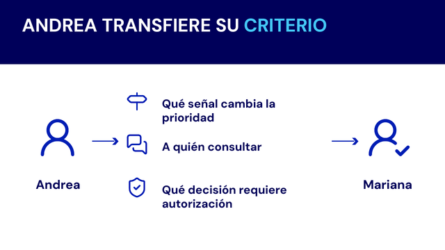

# 031 · Andrea transfiere su criterio

Montaje de rescates · pendiente de conciliación. Las propuestas fueron aprobadas; esta ficha no añade una aprobación humana del resultado.

Contexto de publicación: caso ficticio didáctico; no describe personas, valoraciones ni planes sucesorios reales.

## Voz en off literal

En otro turno, Andrea volvió a coordinar con menos apoyo. Antes de entregar el relevo a Mariana, le explicó qué dato la habría hecho cambiar de prioridad, a quién consultar y por qué canal. Mariana usó ese criterio cuando recibió las alertas. Javier anotó qué podía decidir Andrea, qué seguía requiriendo autorización y quién cubriría su trabajo habitual si la siguiente práctica la llevaba a otra área.

## Trazabilidad

| Campo | Valor |
|---|---|
| PPT exacta | `Sucesion_R13_Rescates_aprobados_PENDIENTE_CONCILIACION.pptx` |
| Versión | Montaje de 36 diapositivas realizado sobre R13 versión 6; no sustituye la R13 vigente |
| SHA-256 de la PPT | `73e337f32d15efca401fa11cb2111bce79a00f55f060b7a0baaf676c9634f32a` |
| Posición física en esta PPT | 031 |
| ID nativo | 286 |
| Estado original | Visible |
| PNG exacto | `R13_Rescates_aprobados_73e337f3__031.png` |
| SHA-256 del PNG publicado | `a659b00f55631de851a7342932b6ce4c9d636bc099172bdfb7e8ca642c1333d9` |
| Dimensiones | 640 × 360 px, PNG RGB |
| Exportación | Render final de LibreOffice a 1280 × 720; reducción proporcional Lanczos3 a 640 × 360 con sharp 0.35.5, sin volver a renderizar la PPT |
| SHA-256 del render de producción | `9dcd8f2200190dcadaf4fe09b9fac6f5bff68b42490460e7f4998c7df40fd901` |
| Voz | Literal de R13 versión 6; metadatos y notas de producción excluidos |
| SHA-256 de la voz UTF-8 | `b6e62b32db7a4e7ace8f43e6d04c3a6b5e972917cd8db591402a4252b5f59518` |
| Referencia del rescate | `NextGen_R12_experimento_visual_73_ENTREGA.pptx`, 73 diapositivas, posición 035, ID nativo 319 |
| SHA-256 de R12 | `7a69815752a0187f932c52349fe710e1d55c1190b393cd9cccf9a9c67b0da430` |
| Aprobación y publicación | Propuesta aprobada por Randy; imagen del montaje publicada para revisión, sin modificar R13 |

La miniatura de una variante anterior de R13 en esta posición fue retirada. **Imagen eliminada** para aquella variante: este PNG es una composición nueva, identificada por su PPT y huella, y no restaura el archivo retirado.

## Juicio visual de Sammy · criterio 080

**3 · Afinarla.** El recorrido horizontal es reconocible, pero la combinación de figuras grandes, símbolos centrales pequeños y flechas mucho más finas produce pesos de trazo dispares.

Cambio mínimo propuesto, no ejecutado: Armonizar grosores y remates de flechas e iconos y ajustar la escala óptica de los elementos centrales.

La acción es el nombre de la escala, no una orden aplicada ni un veredicto nuevo de Randy. No se ha verificado una alternativa pública adicional en esta entrega.

## Juicio de locución de Sammy

Relato en tercera persona con explicación referida que da contenido al traspaso de Andrea a Mariana y muestra la aplicación del criterio sin convertir la transferencia en un nombramiento.

Este juicio queda fuera del guion y no modifica la locución literal.

