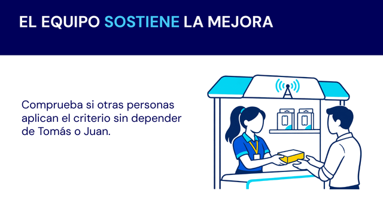

# 032 · El equipo sostiene la mejora

Montaje de rescates · pendiente de conciliación. Las propuestas fueron aprobadas; esta ficha no añade una aprobación humana del resultado.

Contexto de publicación: caso ficticio didáctico; no describe personas, valoraciones ni planes sucesorios reales.

## Voz en off literal

En Ventas, el viernes siguiente Ricardo encontró dos oportunidades con un próximo paso acordado sin intervención de Tomás. Preguntó a los vendedores qué criterio habían usado. Ambos pudieron explicarlo. Ricardo le dio a Tomás un reto mayor. Juan también avanzó: su compañero pudo repetir lo aprendido sin él. Ricardo fijó qué practicaría cada uno y cuándo volvería a observarlo.

## Trazabilidad

| Campo | Valor |
|---|---|
| PPT exacta | `Sucesion_R13_Rescates_aprobados_PENDIENTE_CONCILIACION.pptx` |
| Versión | Montaje de 36 diapositivas realizado sobre R13 versión 6; no sustituye la R13 vigente |
| SHA-256 de la PPT | `73e337f32d15efca401fa11cb2111bce79a00f55f060b7a0baaf676c9634f32a` |
| Posición física en esta PPT | 032 |
| ID nativo | 287 |
| Estado original | Visible |
| PNG exacto | `R13_Rescates_aprobados_73e337f3__032.png` |
| SHA-256 del PNG publicado | `192b718e35eb661b2c72151d8509063e56bfb8514566d3991d6d320f170909c4` |
| Dimensiones | 640 × 360 px, PNG RGB |
| Exportación | Render final de LibreOffice a 1280 × 720; reducción proporcional Lanczos3 a 640 × 360 con sharp 0.35.5, sin volver a renderizar la PPT |
| SHA-256 del render de producción | `b90e986ddc9293b0093105f69cf4fafb031acc6d5960db439f972348b73dfdde` |
| Voz | Literal de R13 versión 6; metadatos y notas de producción excluidos |
| SHA-256 de la voz UTF-8 | `b5da947c0b27ece5830a51c794a0cfec7e9f2875774d4c40cbdc74d99468ef1a` |
| Referencia del rescate | `NextGen_R12_experimento_visual_73_ENTREGA.pptx`, 73 diapositivas, posición 038, ID nativo 322 |
| SHA-256 de R12 | `7a69815752a0187f932c52349fe710e1d55c1190b393cd9cccf9a9c67b0da430` |
| Aprobación y publicación | Propuesta aprobada por Randy; imagen del montaje publicada para revisión, sin modificar R13 |

La miniatura de una variante anterior de R13 en esta posición fue retirada. **Imagen eliminada** para aquella variante: este PNG es una composición nueva, identificada por su PPT y huella, y no restaura el archivo retirado.

## Juicio visual de Sammy · criterio 080

**5 · Aprobadísima.** La escena de atención ocupa una escala protagonista, conserva una silueta nítida y equilibra el bloque izquierdo con contraste, márgenes y espacio negativo suficientes.

Cambio mínimo propuesto, no ejecutado: Sin cambios.

La acción es el nombre de la escala, no una orden aplicada ni un veredicto nuevo de Randy. No se ha verificado una alternativa pública adicional en esta entrega.

## Juicio de locución de Sammy

Narración en tercera persona que aporta la comprobación concreta de que otras personas repiten el criterio sin Tomás o Juan y cierra el caso con la siguiente práctica observable.

Este juicio queda fuera del guion y no modifica la locución literal.

