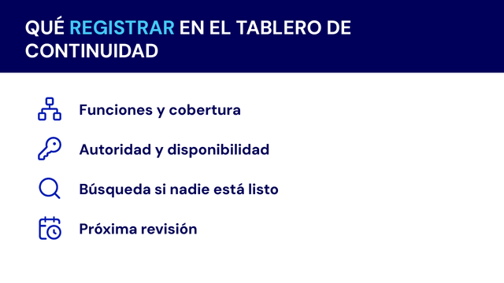

# 033 · Qué registrar en el tablero de continuidad

Montaje de rescates · pendiente de conciliación. Las propuestas fueron aprobadas; esta ficha no añade una aprobación humana del resultado.

## Voz en off literal

En tu tablero de continuidad, registra las funciones que deben seguir cubiertas, quién las puede asumir, qué autoridad tiene y cuándo revisarás el acuerdo. Una persona puede estar preparada y no estar disponible. Antes de contar con ella para un relevo, comprueba qué pasaría con el puesto que dejaría. Y cuando llegue el momento de considerar un ascenso, distingue la preparación de las demás condiciones: una vacante, una necesidad del negocio y una decisión autorizada. Preparar a alguien no crea por sí solo la oportunidad. Si todavía no hay una persona preparada e interesada, deja constancia. Asegura una cobertura temporal y amplía la búsqueda con el mismo criterio: primero en tu equipo, luego en otras áreas y, si corresponde, por los canales de búsqueda externa con Tigo People. También puedes reorganizar funciones si eso sostiene el trabajo. La urgencia cambia la cobertura, no la evidencia de preparación.

## Trazabilidad

| Campo | Valor |
|---|---|
| PPT exacta | `Sucesion_R13_Rescates_aprobados_PENDIENTE_CONCILIACION.pptx` |
| Versión | Montaje de 36 diapositivas realizado sobre R13 versión 6; no sustituye la R13 vigente |
| SHA-256 de la PPT | `73e337f32d15efca401fa11cb2111bce79a00f55f060b7a0baaf676c9634f32a` |
| Posición física en esta PPT | 033 |
| ID nativo | 288 |
| Estado original | Visible |
| PNG exacto | `R13_Rescates_aprobados_73e337f3__033.png` |
| SHA-256 del PNG publicado | `e29cf09ffffec4b0d679a43b3ed5988248cfd407dab7767d7a5621b9b3770b98` |
| Dimensiones | 640 × 360 px, PNG RGB |
| Exportación | Render final de LibreOffice a 1280 × 720; reducción proporcional Lanczos3 a 640 × 360 con sharp 0.35.5, sin volver a renderizar la PPT |
| SHA-256 del render de producción | `c089d87c6f2afe04d3594a9100e991ba4857e7d050451cb8e2c70b78dcac4fe2` |
| Voz | Literal de R13 versión 6; metadatos y notas de producción excluidos |
| SHA-256 de la voz UTF-8 | `254b88cdcec6713edf87b046840786e311f01a33fbd8dcc92d4a471b56f81369` |
| Referencia del rescate | `NextGen_R12_experimento_visual_73_ENTREGA.pptx`, 73 diapositivas, posición 036, ID nativo 320 |
| SHA-256 de R12 | `7a69815752a0187f932c52349fe710e1d55c1190b393cd9cccf9a9c67b0da430` |
| Aprobación y publicación | Propuesta aprobada por Randy; imagen del montaje publicada para revisión, sin modificar R13 |

## Juicio visual de Sammy · criterio 080

**1 · Eliminarla.** Las cuatro filas clonadas de icono y texto ocupan solo la izquierda y dejan una gran superficie derecha vacía sin un sistema gráfico focal reconocible.

Cambio mínimo propuesto, no ejecutado: No basta un pulido localizado: recomponer los cuatro campos como una pieza gráfica unitaria, preservando íntegramente el contenido.

La acción es el nombre de la escala, no una orden aplicada ni un veredicto nuevo de Randy. No se ha verificado una alternativa pública adicional en esta entrega.

## Juicio de locución de Sammy

Orientación en tuteo que amplía los cuatro campos del tablero, aunque la acumulación de cobertura, disponibilidad, condiciones de ascenso y búsqueda exige pausas entre decisiones para mantener la claridad oral.

Este juicio queda fuera del guion y no modifica la locución literal.

