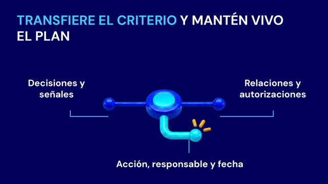

# 034 · Transfiere el criterio y mantén vivo el plan

Montaje de rescates · pendiente de conciliación. Las propuestas fueron aprobadas; esta ficha no añade una aprobación humana del resultado.

## Voz en off literal

Cuando corresponda una transición, transfiere decisiones, relaciones y criterios, además de procedimientos. Escoge una decisión reciente: cuenta qué señal viste, qué opción descartaste y qué dato te habría hecho cambiar de rumbo. Presenta a las personas con quienes habrá que coordinar. Si todos siguen consultando al titular anterior, revisa qué criterio, relación o autorización quedó pendiente. Reduce el acompañamiento conforme veas evidencia de autonomía.

Usa los registros que ya existen. Si comparas cifras, verifica que midan lo mismo, durante el mismo período y con el mismo criterio. Si un proyecto se cancela o el puesto cambia, revisa la parte del plan afectada y conserva lo que todavía sirve. En cada revisión deja una acción, un responsable y una fecha.

## Trazabilidad

| Campo | Valor |
|---|---|
| PPT exacta | `Sucesion_R13_Rescates_aprobados_PENDIENTE_CONCILIACION.pptx` |
| Versión | Montaje de 36 diapositivas realizado sobre R13 versión 6; no sustituye la R13 vigente |
| SHA-256 de la PPT | `73e337f32d15efca401fa11cb2111bce79a00f55f060b7a0baaf676c9634f32a` |
| Posición física en esta PPT | 034 |
| ID nativo | 289 |
| Estado original | Visible |
| PNG exacto | `R13_Rescates_aprobados_73e337f3__034.png` |
| SHA-256 del PNG publicado | `7d9f01f0d8b7ec1307fc963dfe53049637caad9b5adaae9b26cc57dbcbcc0e08` |
| Dimensiones | 640 × 360 px, PNG RGB |
| Exportación | Render final de LibreOffice a 1280 × 720; reducción proporcional Lanczos3 a 640 × 360 con sharp 0.35.5, sin volver a renderizar la PPT |
| SHA-256 del render de producción | `c948988f86cac3b7f1ad403a1235f4befe1b34e2f157e9ad3dfa887ff2006b74` |
| Voz | Literal de R13 versión 6; metadatos y notas de producción excluidos |
| SHA-256 de la voz UTF-8 | `f0ff0f5429b8f4f641be3881e283dd4f2265fb27cba18d766a9709c79e5c3135` |
| Referencia del rescate | `NextGen_R12_experimento_visual_73_ENTREGA.pptx`, 73 diapositivas, posición 065, ID nativo 275 |
| SHA-256 de R12 | `7a69815752a0187f932c52349fe710e1d55c1190b393cd9cccf9a9c67b0da430` |
| Aprobación y publicación | Propuesta aprobada por Randy; imagen del montaje publicada para revisión, sin modificar R13 |

La miniatura de una variante anterior de R13 en esta posición fue retirada. **Imagen eliminada** para aquella variante: este PNG es una composición nueva, identificada por su PPT y huella, y no restaura el archivo retirado.

## Juicio visual de Sammy · criterio 080

**3 · Afinarla.** El nodo central aporta una silueta singular, pero los codos finos de las llamadas y su separación del objeto se sienten desconectados del peso volumétrico de la ilustración.

Cambio mínimo propuesto, no ejecutado: Acercar y armonizar los trazos de llamada y los márgenes de las etiquetas, conservando el nodo aprobado.

La acción es el nombre de la escala, no una orden aplicada ni un veredicto nuevo de Randy. No se ha verificado una alternativa pública adicional en esta entrega.

## Juicio de locución de Sammy

Narración en tuteo que convierte las tres ramas visuales en acciones concretas de transferencia y revisión, separando el ejemplo de decisión de las indicaciones para mantener actualizado el plan.

Este juicio queda fuera del guion y no modifica la locución literal.

