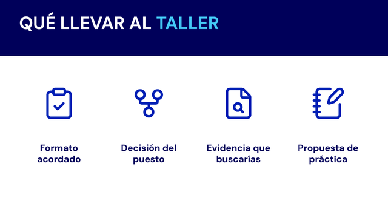

# 035 · Qué llevar al taller

Montaje de rescates · pendiente de conciliación. Las propuestas fueron aprobadas; esta ficha no añade una aprobación humana del resultado.

## Voz en off literal

Para el taller, trae actualizado el formato de contribución de tu puesto, acordado con tu líder inmediato y listo para revisar. Elige una decisión que ese puesto tenga que sostener. Trae un ejemplo de qué evidencia buscarías en otra persona y una propuesta de práctica. Si todavía no identificas a alguien, trae la pregunta que te falta resolver; no hace falta llevar un nombre.

Allí vas a recibir las plantillas. Las vas a completar con un caso de práctica y entregarás los formatos llenos. Después las aplicarás en tu puesto, con evidencias de tu operación y por los canales autorizados. Mantén en reserva la información personal del ejercicio real.

## Trazabilidad

| Campo | Valor |
|---|---|
| PPT exacta | `Sucesion_R13_Rescates_aprobados_PENDIENTE_CONCILIACION.pptx` |
| Versión | Montaje de 36 diapositivas realizado sobre R13 versión 6; no sustituye la R13 vigente |
| SHA-256 de la PPT | `73e337f32d15efca401fa11cb2111bce79a00f55f060b7a0baaf676c9634f32a` |
| Posición física en esta PPT | 035 |
| ID nativo | 290 |
| Estado original | Visible |
| PNG exacto | `R13_Rescates_aprobados_73e337f3__035.png` |
| SHA-256 del PNG publicado | `ee0d89f1efeba3423e86ef39d68f6b61fad602a8915410cb5bf1f588b922b34a` |
| Dimensiones | 640 × 360 px, PNG RGB |
| Exportación | Render final de LibreOffice a 1280 × 720; reducción proporcional Lanczos3 a 640 × 360 con sharp 0.35.5, sin volver a renderizar la PPT |
| SHA-256 del render de producción | `e25ba76f4b9de78fe06a20e21f27a5fd8446e275ea3055ae9abd862b703406ac` |
| Voz | Literal de R13 versión 6; metadatos y notas de producción excluidos |
| SHA-256 de la voz UTF-8 | `7b430b7a9179498b5e8af976d685a534f878e7d4fd23dca42b9c70b309a62bff` |
| Referencia del rescate | `NextGen_R12_experimento_visual_73_ENTREGA.pptx`, 73 diapositivas, posición 069, ID nativo 279 |
| SHA-256 de R12 | `7a69815752a0187f932c52349fe710e1d55c1190b393cd9cccf9a9c67b0da430` |
| Aprobación y publicación | Propuesta aprobada por Randy; imagen del montaje publicada para revisión, sin modificar R13 |

La miniatura de una variante anterior de R13 en esta posición fue retirada. **Imagen eliminada** para aquella variante: este PNG es una composición nueva, identificada por su PPT y huella, y no restaura el archivo retirado.

## Juicio visual de Sammy · criterio 080

**4 · Pulirla.** La fila de cuatro símbolos mantiene alineación, trazo y etiquetas de dos líneas consistentes, aunque los iconos de ramificación y documento no tienen exactamente el mismo peso óptico.

Cambio mínimo propuesto, no ejecutado: Normalizar ligeramente la escala óptica de los cuatro iconos manteniendo sus centros y etiquetas.

La acción es el nombre de la escala, no una orden aplicada ni un veredicto nuevo de Randy. No se ha verificado una alternativa pública adicional en esta entrega.

## Juicio de locución de Sammy

Instrucción en tuteo que distingue preparación previa, trabajo en el taller y aplicación posterior, complementa los cuatro insumos de pantalla y aclara que no hace falta llegar con un nombre.

Este juicio queda fuera del guion y no modifica la locución literal.

