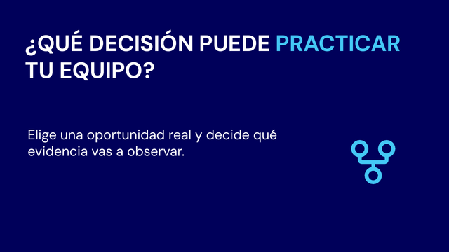

# 036 · ¿Qué decisión puede practicar tu equipo?

Montaje de rescates · pendiente de conciliación. Las propuestas fueron aprobadas; esta ficha no añade una aprobación humana del resultado.

## Voz en off literal

Antes de cerrar, vuelve a la decisión que imaginaste al comienzo. Si mañana alguien tuviera que tomarla, ¿sabría en qué señal fijarse y en qué momento pedir apoyo? Elige una oportunidad real para que pueda practicarla. Decide hoy qué espacio le vas a abrir y qué evidencia te mostrará que puede dar el siguiente paso.

## Trazabilidad

| Campo | Valor |
|---|---|
| PPT exacta | `Sucesion_R13_Rescates_aprobados_PENDIENTE_CONCILIACION.pptx` |
| Versión | Montaje de 36 diapositivas realizado sobre R13 versión 6; no sustituye la R13 vigente |
| SHA-256 de la PPT | `73e337f32d15efca401fa11cb2111bce79a00f55f060b7a0baaf676c9634f32a` |
| Posición física en esta PPT | 036 |
| ID nativo | 291 |
| Estado original | Visible |
| PNG exacto | `R13_Rescates_aprobados_73e337f3__036.png` |
| SHA-256 del PNG publicado | `bd7dd571e7b4ee2c7d2d188a43299775b59cec4c180835cb34b4c654192c7649` |
| Dimensiones | 640 × 360 px, PNG RGB |
| Exportación | Render final de LibreOffice a 1280 × 720; reducción proporcional Lanczos3 a 640 × 360 con sharp 0.35.5, sin volver a renderizar la PPT |
| SHA-256 del render de producción | `6c55e94ab73e67fc5cff882431c0792d13ecd8eb8ea2a473e35221a1459c11cb` |
| Voz | Literal de R13 versión 6; metadatos y notas de producción excluidos |
| SHA-256 de la voz UTF-8 | `4b921ba949695fc53911945bc9e6e4309538ee28ac7e5cc812edc6bacf3b1471` |
| Referencia del rescate | `NextGen_R12_experimento_visual_73_ENTREGA.pptx`, 73 diapositivas, posición 070, ID nativo 280 |
| SHA-256 de R12 | `7a69815752a0187f932c52349fe710e1d55c1190b393cd9cccf9a9c67b0da430` |
| Aprobación y publicación | Propuesta aprobada por Randy; imagen del montaje publicada para revisión, sin modificar R13 |

La miniatura de una variante anterior de R13 en esta posición fue retirada. **Imagen eliminada** para aquella variante: este PNG es una composición nueva, identificada por su PPT y huella, y no restaura el archivo retirado.

## Juicio visual de Sammy · criterio 080

**3 · Afinarla.** La pregunta en gran formato establece un foco tipográfico reconocible, pero el icono pequeño queda aislado y la separación entre los dos bloques de texto dispersa la composición.

Cambio mínimo propuesto, no ejecutado: Compactar la distancia entre pregunta y apoyo e integrar ópticamente el icono mediante posición y escala, sin cambiar el texto.

La acción es el nombre de la escala, no una orden aplicada ni un veredicto nuevo de Randy. No se ha verificado una alternativa pública adicional en esta entrega.

## Juicio de locución de Sammy

Cierre en tuteo con una pregunta de reflexión que conecta la decisión inicial con una práctica y una evidencia concretas, sin introducir un diálogo ni nuevos compromisos ajenos a la pantalla.

Este juicio queda fuera del guion y no modifica la locución literal.

