# Rescates de R12 para R13 · montaje pendiente de conciliación
## Vigente · Decisión036 · 2026-11-23

PROGRAMA007 se conserva en R13B. El puente se trasladó sin textos ni locución a **R13B Addendum021** y se retiró de Rescates007/008 y de R12004. Las miniaturas007 y008 de este índice muestran ahora las mismas diapositivas sin el puente; textos y locuciones se conservan. El contact007 cerrado se retiró de la rama activa, con recuperación en Git. No se publica otra copia del puente.

Las tablas, hashes globales y juicios de la publicación original siguientes son historial; las fichas007/008 y las entradas correspondientes del manifiesto incluyen los hashes actuales y la actualización parcial. Esto no vuelve a aprobar las propuestas restantes.

**31 láminas compuestas y 9 capas obtenidas mediante edición generativa**, publicadas como PNG con su Markdown del mismo nombre base. No son 31 ilustraciones nuevas generadas por IA.

Fuente exacta: `Sucesion_R13_Rescates_aprobados_PENDIENTE_CONCILIACION.pptx` · 36 diapositivas · SHA-256 `73e337f32d15efca401fa11cb2111bce79a00f55f060b7a0baaf676c9634f32a`.

Este montaje se produjo sobre R13 versión 6. **No sustituye la R13 vigente.** La numeración que aparece aquí corresponde a la posición física en este montaje. Las propuestas fueron aprobadas por Randy; los juicios de Sammy se conservan separados y no añaden ni cambian veredictos humanos.

Las 31 imágenes de diapositiva son PNG RGB de 640 × 360 px. Se reutilizaron los renders finales ya verificados, reducidos proporcionalmente; no se volvió a renderizar ni editar la PPT. Cada ficha contiene la locución literal, la trazabilidad y los juicios visual y de locución por separado. Los casos con nombres son ficticios didácticos, no registros de colaboradores reales.

## Alcance y exclusiones

| Grupo | Nuevas | Ya publicadas y reutilizadas en este lote | Excluidas | Motivo |
|---|---:|---:|---:|---|
| Láminas compuestas | 31 | 0 | 5 | 001–004 y 028 se conservaron; no son resultados nuevos de los rescates |
| Capas generativas seleccionadas | 9 | 0 | 1 | La capa R12 038 ya tenía transparencia: se reutilizó, no se generó |

- 001: apertura conservada y fuera del tramo de rescates; no se duplica su imagen.
- 002, 003 y 004: aperturas conservadas y fuera del tramo de rescates. **Imagen eliminada** para sus antiguas miniaturas retiradas; no se recuperan.
- 028 · ID 283: decisión de conservar R13, sin composición nueva. **Imagen eliminada** para la miniatura retirada; no se republica desde la PPT.
- R12 038 · ID 322: recurso original reutilizado dentro de la nueva composición 032; no se publica como una capa generada nueva.
- Intentos rechazados de extracción: R12 015 (dos), 020, 023 y 030; intentos no seleccionados de 021 y 027. No forman parte de esta publicación.
- No se publican notas técnicas, instrucciones de producción, rutas locales, enlaces privados, la guía interna ni datos sensibles reales.

Las rutas públicas preexistentes se conservan sin cambios. Las variantes antiguas retiradas no se restauran; los renders nuevos se identifican por su fuente y huella.

## Índice de las 31 láminas

| Posición | ID nativo | Lámina y voz | Referencia R12 | Juicio gráfico de Sammy |
|---|---:|---|---|---|
| 005 | 260 | [Multiplica tu Talento](https://github.com/nkrikamo/RandyPublic/blob/main/010_SucesionNextGenConnectors/UniversoDeSlides/069_Sucesion_R13_Rescates_aprobados_PENDIENTE_CONCILIACION/005/R13_Rescates_aprobados_73e337f3__005.md) | 002 · ID 257 | 5 · Aprobadísima |
| 006 | 261 | [La sucesión beneficia a los tres](https://github.com/nkrikamo/RandyPublic/blob/main/010_SucesionNextGenConnectors/UniversoDeSlides/069_Sucesion_R13_Rescates_aprobados_PENDIENTE_CONCILIACION/006/R13_Rescates_aprobados_73e337f3__006.md) | 003 · ID 287 | 4 · Pulirla |
| 007 | 262 | [Un trabajo compartido](https://github.com/nkrikamo/RandyPublic/blob/main/010_SucesionNextGenConnectors/UniversoDeSlides/069_Sucesion_R13_Rescates_aprobados_PENDIENTE_CONCILIACION/007/R13_Rescates_aprobados_73e337f3__007.md) | 004 · ID 288 | 4 · Pulirla |
| 008 | 263 | [El desarrollo exige compromiso](https://github.com/nkrikamo/RandyPublic/blob/main/010_SucesionNextGenConnectors/UniversoDeSlides/069_Sucesion_R13_Rescates_aprobados_PENDIENTE_CONCILIACION/008/R13_Rescates_aprobados_73e337f3__008.md) | 004 · ID 288 | 3 · Afinarla |
| 009 | 264 | [El puesto y el talento](https://github.com/nkrikamo/RandyPublic/blob/main/010_SucesionNextGenConnectors/UniversoDeSlides/069_Sucesion_R13_Rescates_aprobados_PENDIENTE_CONCILIACION/009/R13_Rescates_aprobados_73e337f3__009.md) | 006 · ID 290 | 5 · Aprobadísima |
| 010 | 265 | [El desarrollo y la continuidad](https://github.com/nkrikamo/RandyPublic/blob/main/010_SucesionNextGenConnectors/UniversoDeSlides/069_Sucesion_R13_Rescates_aprobados_PENDIENTE_CONCILIACION/010/R13_Rescates_aprobados_73e337f3__010.md) | 006 · ID 290 | 5 · Aprobadísima |
| 011 | 266 | [Deja tu puesto mejor preparado](https://github.com/nkrikamo/RandyPublic/blob/main/010_SucesionNextGenConnectors/UniversoDeSlides/069_Sucesion_R13_Rescates_aprobados_PENDIENTE_CONCILIACION/011/R13_Rescates_aprobados_73e337f3__011.md) | 007 · ID 291 | 4 · Pulirla |
| 012 | 267 | [El modelo de brechas](https://github.com/nkrikamo/RandyPublic/blob/main/010_SucesionNextGenConnectors/UniversoDeSlides/069_Sucesion_R13_Rescates_aprobados_PENDIENTE_CONCILIACION/012/R13_Rescates_aprobados_73e337f3__012.md) | 029 · ID 313 | 4 · Pulirla |
| 013 | 268 | [Revisa la contribución de tu rol](https://github.com/nkrikamo/RandyPublic/blob/main/010_SucesionNextGenConnectors/UniversoDeSlides/069_Sucesion_R13_Rescates_aprobados_PENDIENTE_CONCILIACION/013/R13_Rescates_aprobados_73e337f3__013.md) | 010 · ID 294 | 4 · Pulirla |
| 014 | 269 | [El formato define el punto B](https://github.com/nkrikamo/RandyPublic/blob/main/010_SucesionNextGenConnectors/UniversoDeSlides/069_Sucesion_R13_Rescates_aprobados_PENDIENTE_CONCILIACION/014/R13_Rescates_aprobados_73e337f3__014.md) | 054 · ID 264 | 4 · Pulirla |
| 015 | 270 | [Hoy y futuro: la misma capacidad](https://github.com/nkrikamo/RandyPublic/blob/main/010_SucesionNextGenConnectors/UniversoDeSlides/069_Sucesion_R13_Rescates_aprobados_PENDIENTE_CONCILIACION/015/R13_Rescates_aprobados_73e337f3__015.md) | 051 · ID 263 | 5 · Aprobadísima |
| 016 | 271 | [Operaciones: ¿cerrar o volver a comprobar?](https://github.com/nkrikamo/RandyPublic/blob/main/010_SucesionNextGenConnectors/UniversoDeSlides/069_Sucesion_R13_Rescates_aprobados_PENDIENTE_CONCILIACION/016/R13_Rescates_aprobados_73e337f3__016.md) | 015 · ID 299 | 3 · Afinarla |
| 017 | 272 | [Ventas: el resultado del equipo](https://github.com/nkrikamo/RandyPublic/blob/main/010_SucesionNextGenConnectors/UniversoDeSlides/069_Sucesion_R13_Rescates_aprobados_PENDIENTE_CONCILIACION/017/R13_Rescates_aprobados_73e337f3__017.md) | 017 · ID 301 | 4 · Pulirla |
| 018 | 273 | [Una misma vara para identificar talento](https://github.com/nkrikamo/RandyPublic/blob/main/010_SucesionNextGenConnectors/UniversoDeSlides/069_Sucesion_R13_Rescates_aprobados_PENDIENTE_CONCILIACION/018/R13_Rescates_aprobados_73e337f3__018.md) | 019 · ID 303 | 4 · Pulirla |
| 019 | 274 | [Operaciones: la evidencia que faltaba](https://github.com/nkrikamo/RandyPublic/blob/main/010_SucesionNextGenConnectors/UniversoDeSlides/069_Sucesion_R13_Rescates_aprobados_PENDIENTE_CONCILIACION/019/R13_Rescates_aprobados_73e337f3__019.md) | 023 · ID 307 | 3 · Afinarla |
| 020 | 275 | [La conversación de carrera](https://github.com/nkrikamo/RandyPublic/blob/main/010_SucesionNextGenConnectors/UniversoDeSlides/069_Sucesion_R13_Rescates_aprobados_PENDIENTE_CONCILIACION/020/R13_Rescates_aprobados_73e337f3__020.md) | 021 · ID 305 | 3 · Afinarla |
| 021 | 276 | [Una oportunidad de práctica para cada perfil](https://github.com/nkrikamo/RandyPublic/blob/main/010_SucesionNextGenConnectors/UniversoDeSlides/069_Sucesion_R13_Rescates_aprobados_PENDIENTE_CONCILIACION/021/R13_Rescates_aprobados_73e337f3__021.md) | 022 · ID 306 | 3 · Afinarla |
| 022 | 277 | [Ventas: orientar sin sustituir](https://github.com/nkrikamo/RandyPublic/blob/main/010_SucesionNextGenConnectors/UniversoDeSlides/069_Sucesion_R13_Rescates_aprobados_PENDIENTE_CONCILIACION/022/R13_Rescates_aprobados_73e337f3__022.md) | 024 · ID 308 | 5 · Aprobadísima |
| 023 | 278 | [Comparte criterios y protege las valoraciones](https://github.com/nkrikamo/RandyPublic/blob/main/010_SucesionNextGenConnectors/UniversoDeSlides/069_Sucesion_R13_Rescates_aprobados_PENDIENTE_CONCILIACION/023/R13_Rescates_aprobados_73e337f3__023.md) | 020 · ID 304 | 4 · Pulirla |
| 024 | 279 | [Convierte la brecha en una práctica real](https://github.com/nkrikamo/RandyPublic/blob/main/010_SucesionNextGenConnectors/UniversoDeSlides/069_Sucesion_R13_Rescates_aprobados_PENDIENTE_CONCILIACION/024/R13_Rescates_aprobados_73e337f3__024.md) | 029 · ID 313 | 3 · Afinarla |
| 025 | 280 | [Abre la oportunidad antes de repartir el trabajo](https://github.com/nkrikamo/RandyPublic/blob/main/010_SucesionNextGenConnectors/UniversoDeSlides/069_Sucesion_R13_Rescates_aprobados_PENDIENTE_CONCILIACION/025/R13_Rescates_aprobados_73e337f3__025.md) | 027 · ID 311 | 4 · Pulirla |
| 026 | 281 | [Andrea practica con respaldo](https://github.com/nkrikamo/RandyPublic/blob/main/010_SucesionNextGenConnectors/UniversoDeSlides/069_Sucesion_R13_Rescates_aprobados_PENDIENTE_CONCILIACION/026/R13_Rescates_aprobados_73e337f3__026.md) | 030 · ID 314 | 4 · Pulirla |
| 027 | 282 | [Andrea decide cuándo escalar](https://github.com/nkrikamo/RandyPublic/blob/main/010_SucesionNextGenConnectors/UniversoDeSlides/069_Sucesion_R13_Rescates_aprobados_PENDIENTE_CONCILIACION/027/R13_Rescates_aprobados_73e337f3__027.md) | 031 · ID 315 | 4 · Pulirla |
| 029 | 284 | [Tres evidencias para revisar el PDI](https://github.com/nkrikamo/RandyPublic/blob/main/010_SucesionNextGenConnectors/UniversoDeSlides/069_Sucesion_R13_Rescates_aprobados_PENDIENTE_CONCILIACION/029/R13_Rescates_aprobados_73e337f3__029.md) | 062 · ID 272 | 4 · Pulirla |
| 030 | 285 | [Cubrir hoy y preparar el relevo](https://github.com/nkrikamo/RandyPublic/blob/main/010_SucesionNextGenConnectors/UniversoDeSlides/069_Sucesion_R13_Rescates_aprobados_PENDIENTE_CONCILIACION/030/R13_Rescates_aprobados_73e337f3__030.md) | 064 · ID 274 | 4 · Pulirla |
| 031 | 286 | [Andrea transfiere su criterio](https://github.com/nkrikamo/RandyPublic/blob/main/010_SucesionNextGenConnectors/UniversoDeSlides/069_Sucesion_R13_Rescates_aprobados_PENDIENTE_CONCILIACION/031/R13_Rescates_aprobados_73e337f3__031.md) | 035 · ID 319 | 3 · Afinarla |
| 032 | 287 | [El equipo sostiene la mejora](https://github.com/nkrikamo/RandyPublic/blob/main/010_SucesionNextGenConnectors/UniversoDeSlides/069_Sucesion_R13_Rescates_aprobados_PENDIENTE_CONCILIACION/032/R13_Rescates_aprobados_73e337f3__032.md) | 038 · ID 322 | 5 · Aprobadísima |
| 033 | 288 | [Qué registrar en el tablero de continuidad](https://github.com/nkrikamo/RandyPublic/blob/main/010_SucesionNextGenConnectors/UniversoDeSlides/069_Sucesion_R13_Rescates_aprobados_PENDIENTE_CONCILIACION/033/R13_Rescates_aprobados_73e337f3__033.md) | 036 · ID 320 | 1 · Eliminarla |
| 034 | 289 | [Transfiere el criterio y mantén vivo el plan](https://github.com/nkrikamo/RandyPublic/blob/main/010_SucesionNextGenConnectors/UniversoDeSlides/069_Sucesion_R13_Rescates_aprobados_PENDIENTE_CONCILIACION/034/R13_Rescates_aprobados_73e337f3__034.md) | 065 · ID 275 | 3 · Afinarla |
| 035 | 290 | [Qué llevar al taller](https://github.com/nkrikamo/RandyPublic/blob/main/010_SucesionNextGenConnectors/UniversoDeSlides/069_Sucesion_R13_Rescates_aprobados_PENDIENTE_CONCILIACION/035/R13_Rescates_aprobados_73e337f3__035.md) | 069 · ID 279 | 4 · Pulirla |
| 036 | 291 | [¿Qué decisión puede practicar tu equipo?](https://github.com/nkrikamo/RandyPublic/blob/main/010_SucesionNextGenConnectors/UniversoDeSlides/069_Sucesion_R13_Rescates_aprobados_PENDIENTE_CONCILIACION/036/R13_Rescates_aprobados_73e337f3__036.md) | 070 · ID 280 | 3 · Afinarla |

Las etiquetas de la escala son valoraciones, no acciones ejecutadas. En particular, el juicio 1 de la nueva composición 033 no autoriza retirarla ni modifica la aprobación de la propuesta.

## Galería de las 31 láminas

### 005 · Multiplica tu Talento

ID nativo 260 · [voz literal y trazabilidad](https://github.com/nkrikamo/RandyPublic/blob/main/010_SucesionNextGenConnectors/UniversoDeSlides/069_Sucesion_R13_Rescates_aprobados_PENDIENTE_CONCILIACION/005/R13_Rescates_aprobados_73e337f3__005.md)

### 006 · La sucesión beneficia a los tres

ID nativo 261 · [voz literal y trazabilidad](https://github.com/nkrikamo/RandyPublic/blob/main/010_SucesionNextGenConnectors/UniversoDeSlides/069_Sucesion_R13_Rescates_aprobados_PENDIENTE_CONCILIACION/006/R13_Rescates_aprobados_73e337f3__006.md)

### 007 · Un trabajo compartido

ID nativo 262 · [voz literal y trazabilidad](https://github.com/nkrikamo/RandyPublic/blob/main/010_SucesionNextGenConnectors/UniversoDeSlides/069_Sucesion_R13_Rescates_aprobados_PENDIENTE_CONCILIACION/007/R13_Rescates_aprobados_73e337f3__007.md)

### 008 · El desarrollo exige compromiso

ID nativo 263 · [voz literal y trazabilidad](https://github.com/nkrikamo/RandyPublic/blob/main/010_SucesionNextGenConnectors/UniversoDeSlides/069_Sucesion_R13_Rescates_aprobados_PENDIENTE_CONCILIACION/008/R13_Rescates_aprobados_73e337f3__008.md)

### 009 · El puesto y el talento

ID nativo 264 · [voz literal y trazabilidad](https://github.com/nkrikamo/RandyPublic/blob/main/010_SucesionNextGenConnectors/UniversoDeSlides/069_Sucesion_R13_Rescates_aprobados_PENDIENTE_CONCILIACION/009/R13_Rescates_aprobados_73e337f3__009.md)

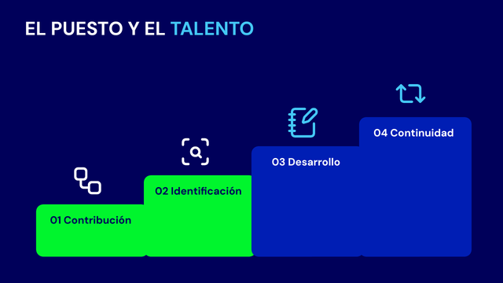

### 010 · El desarrollo y la continuidad

ID nativo 265 · [voz literal y trazabilidad](https://github.com/nkrikamo/RandyPublic/blob/main/010_SucesionNextGenConnectors/UniversoDeSlides/069_Sucesion_R13_Rescates_aprobados_PENDIENTE_CONCILIACION/010/R13_Rescates_aprobados_73e337f3__010.md)

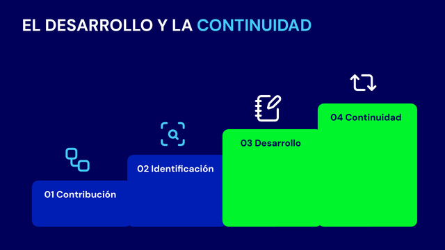

### 011 · Deja tu puesto mejor preparado

ID nativo 266 · [voz literal y trazabilidad](https://github.com/nkrikamo/RandyPublic/blob/main/010_SucesionNextGenConnectors/UniversoDeSlides/069_Sucesion_R13_Rescates_aprobados_PENDIENTE_CONCILIACION/011/R13_Rescates_aprobados_73e337f3__011.md)

### 012 · El modelo de brechas

ID nativo 267 · [voz literal y trazabilidad](https://github.com/nkrikamo/RandyPublic/blob/main/010_SucesionNextGenConnectors/UniversoDeSlides/069_Sucesion_R13_Rescates_aprobados_PENDIENTE_CONCILIACION/012/R13_Rescates_aprobados_73e337f3__012.md)

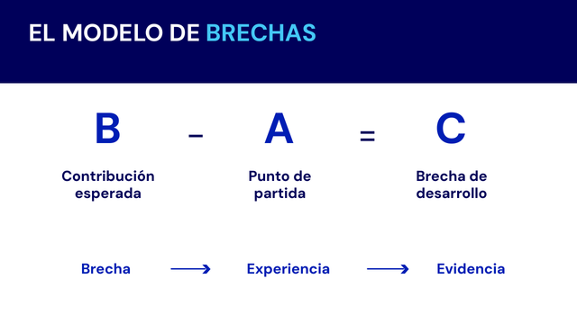

### 013 · Revisa la contribución de tu rol

ID nativo 268 · [voz literal y trazabilidad](https://github.com/nkrikamo/RandyPublic/blob/main/010_SucesionNextGenConnectors/UniversoDeSlides/069_Sucesion_R13_Rescates_aprobados_PENDIENTE_CONCILIACION/013/R13_Rescates_aprobados_73e337f3__013.md)

### 014 · El formato define el punto B

ID nativo 269 · [voz literal y trazabilidad](https://github.com/nkrikamo/RandyPublic/blob/main/010_SucesionNextGenConnectors/UniversoDeSlides/069_Sucesion_R13_Rescates_aprobados_PENDIENTE_CONCILIACION/014/R13_Rescates_aprobados_73e337f3__014.md)

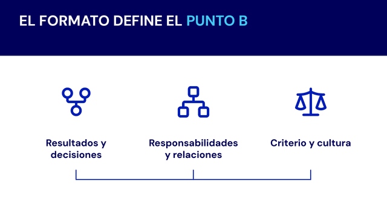

### 015 · Hoy y futuro: la misma capacidad

ID nativo 270 · [voz literal y trazabilidad](https://github.com/nkrikamo/RandyPublic/blob/main/010_SucesionNextGenConnectors/UniversoDeSlides/069_Sucesion_R13_Rescates_aprobados_PENDIENTE_CONCILIACION/015/R13_Rescates_aprobados_73e337f3__015.md)

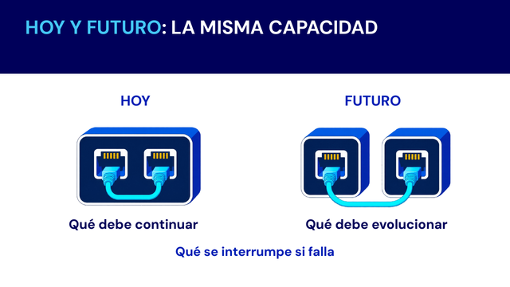

### 016 · Operaciones: ¿cerrar o volver a comprobar?

ID nativo 271 · [voz literal y trazabilidad](https://github.com/nkrikamo/RandyPublic/blob/main/010_SucesionNextGenConnectors/UniversoDeSlides/069_Sucesion_R13_Rescates_aprobados_PENDIENTE_CONCILIACION/016/R13_Rescates_aprobados_73e337f3__016.md)

### 017 · Ventas: el resultado del equipo

ID nativo 272 · [voz literal y trazabilidad](https://github.com/nkrikamo/RandyPublic/blob/main/010_SucesionNextGenConnectors/UniversoDeSlides/069_Sucesion_R13_Rescates_aprobados_PENDIENTE_CONCILIACION/017/R13_Rescates_aprobados_73e337f3__017.md)

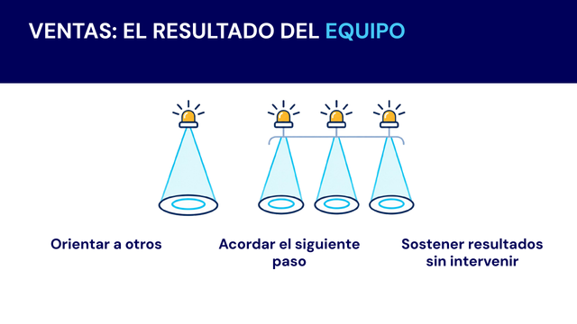

### 018 · Una misma vara para identificar talento

ID nativo 273 · [voz literal y trazabilidad](https://github.com/nkrikamo/RandyPublic/blob/main/010_SucesionNextGenConnectors/UniversoDeSlides/069_Sucesion_R13_Rescates_aprobados_PENDIENTE_CONCILIACION/018/R13_Rescates_aprobados_73e337f3__018.md)

### 019 · Operaciones: la evidencia que faltaba

ID nativo 274 · [voz literal y trazabilidad](https://github.com/nkrikamo/RandyPublic/blob/main/010_SucesionNextGenConnectors/UniversoDeSlides/069_Sucesion_R13_Rescates_aprobados_PENDIENTE_CONCILIACION/019/R13_Rescates_aprobados_73e337f3__019.md)

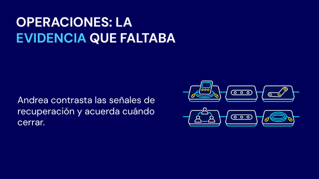

### 020 · La conversación de carrera

ID nativo 275 · [voz literal y trazabilidad](https://github.com/nkrikamo/RandyPublic/blob/main/010_SucesionNextGenConnectors/UniversoDeSlides/069_Sucesion_R13_Rescates_aprobados_PENDIENTE_CONCILIACION/020/R13_Rescates_aprobados_73e337f3__020.md)

### 021 · Una oportunidad de práctica para cada perfil

ID nativo 276 · [voz literal y trazabilidad](https://github.com/nkrikamo/RandyPublic/blob/main/010_SucesionNextGenConnectors/UniversoDeSlides/069_Sucesion_R13_Rescates_aprobados_PENDIENTE_CONCILIACION/021/R13_Rescates_aprobados_73e337f3__021.md)

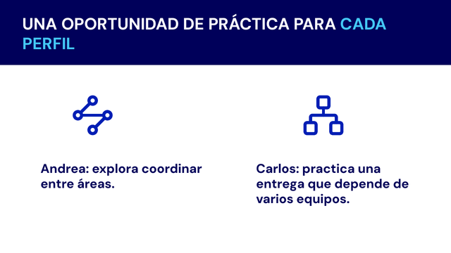

### 022 · Ventas: orientar sin sustituir

ID nativo 277 · [voz literal y trazabilidad](https://github.com/nkrikamo/RandyPublic/blob/main/010_SucesionNextGenConnectors/UniversoDeSlides/069_Sucesion_R13_Rescates_aprobados_PENDIENTE_CONCILIACION/022/R13_Rescates_aprobados_73e337f3__022.md)

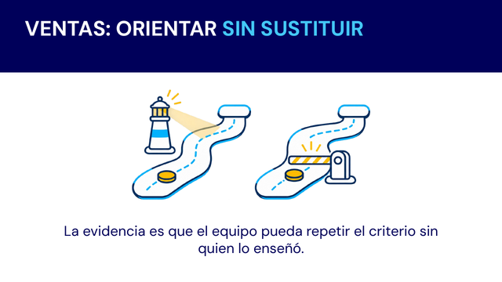

### 023 · Comparte criterios y protege las valoraciones

ID nativo 278 · [voz literal y trazabilidad](https://github.com/nkrikamo/RandyPublic/blob/main/010_SucesionNextGenConnectors/UniversoDeSlides/069_Sucesion_R13_Rescates_aprobados_PENDIENTE_CONCILIACION/023/R13_Rescates_aprobados_73e337f3__023.md)

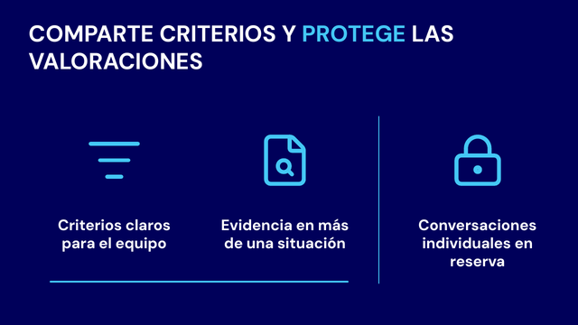

### 024 · Convierte la brecha en una práctica real

ID nativo 279 · [voz literal y trazabilidad](https://github.com/nkrikamo/RandyPublic/blob/main/010_SucesionNextGenConnectors/UniversoDeSlides/069_Sucesion_R13_Rescates_aprobados_PENDIENTE_CONCILIACION/024/R13_Rescates_aprobados_73e337f3__024.md)

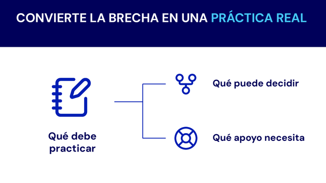

### 025 · Abre la oportunidad antes de repartir el trabajo

ID nativo 280 · [voz literal y trazabilidad](https://github.com/nkrikamo/RandyPublic/blob/main/010_SucesionNextGenConnectors/UniversoDeSlides/069_Sucesion_R13_Rescates_aprobados_PENDIENTE_CONCILIACION/025/R13_Rescates_aprobados_73e337f3__025.md)

### 026 · Andrea practica con respaldo

ID nativo 281 · [voz literal y trazabilidad](https://github.com/nkrikamo/RandyPublic/blob/main/010_SucesionNextGenConnectors/UniversoDeSlides/069_Sucesion_R13_Rescates_aprobados_PENDIENTE_CONCILIACION/026/R13_Rescates_aprobados_73e337f3__026.md)

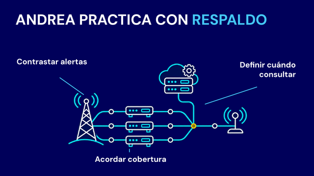

### 027 · Andrea decide cuándo escalar

ID nativo 282 · [voz literal y trazabilidad](https://github.com/nkrikamo/RandyPublic/blob/main/010_SucesionNextGenConnectors/UniversoDeSlides/069_Sucesion_R13_Rescates_aprobados_PENDIENTE_CONCILIACION/027/R13_Rescates_aprobados_73e337f3__027.md)

### 029 · Tres evidencias para revisar el PDI

ID nativo 284 · [voz literal y trazabilidad](https://github.com/nkrikamo/RandyPublic/blob/main/010_SucesionNextGenConnectors/UniversoDeSlides/069_Sucesion_R13_Rescates_aprobados_PENDIENTE_CONCILIACION/029/R13_Rescates_aprobados_73e337f3__029.md)

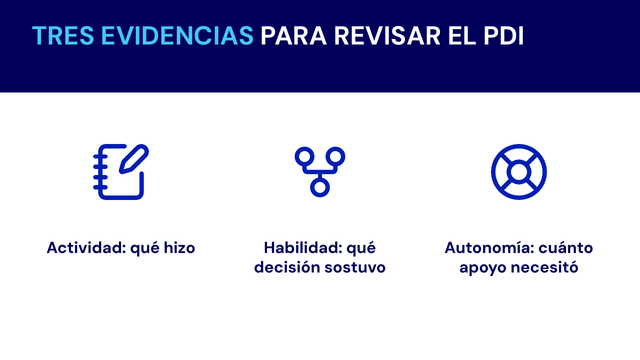

### 030 · Cubrir hoy y preparar el relevo

ID nativo 285 · [voz literal y trazabilidad](https://github.com/nkrikamo/RandyPublic/blob/main/010_SucesionNextGenConnectors/UniversoDeSlides/069_Sucesion_R13_Rescates_aprobados_PENDIENTE_CONCILIACION/030/R13_Rescates_aprobados_73e337f3__030.md)

### 031 · Andrea transfiere su criterio

ID nativo 286 · [voz literal y trazabilidad](https://github.com/nkrikamo/RandyPublic/blob/main/010_SucesionNextGenConnectors/UniversoDeSlides/069_Sucesion_R13_Rescates_aprobados_PENDIENTE_CONCILIACION/031/R13_Rescates_aprobados_73e337f3__031.md)

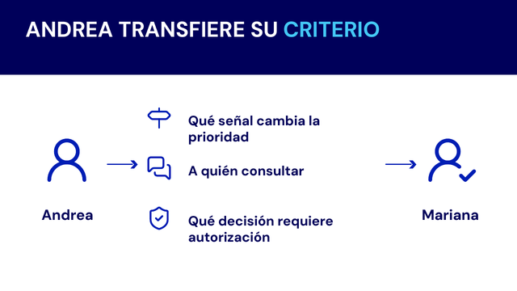

### 032 · El equipo sostiene la mejora

ID nativo 287 · [voz literal y trazabilidad](https://github.com/nkrikamo/RandyPublic/blob/main/010_SucesionNextGenConnectors/UniversoDeSlides/069_Sucesion_R13_Rescates_aprobados_PENDIENTE_CONCILIACION/032/R13_Rescates_aprobados_73e337f3__032.md)

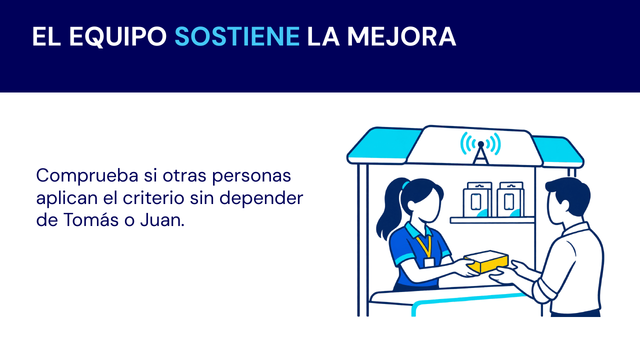

### 033 · Qué registrar en el tablero de continuidad

ID nativo 288 · [voz literal y trazabilidad](https://github.com/nkrikamo/RandyPublic/blob/main/010_SucesionNextGenConnectors/UniversoDeSlides/069_Sucesion_R13_Rescates_aprobados_PENDIENTE_CONCILIACION/033/R13_Rescates_aprobados_73e337f3__033.md)

### 034 · Transfiere el criterio y mantén vivo el plan

ID nativo 289 · [voz literal y trazabilidad](https://github.com/nkrikamo/RandyPublic/blob/main/010_SucesionNextGenConnectors/UniversoDeSlides/069_Sucesion_R13_Rescates_aprobados_PENDIENTE_CONCILIACION/034/R13_Rescates_aprobados_73e337f3__034.md)

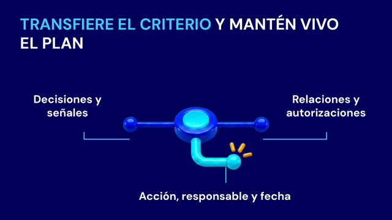

### 035 · Qué llevar al taller

ID nativo 290 · [voz literal y trazabilidad](https://github.com/nkrikamo/RandyPublic/blob/main/010_SucesionNextGenConnectors/UniversoDeSlides/069_Sucesion_R13_Rescates_aprobados_PENDIENTE_CONCILIACION/035/R13_Rescates_aprobados_73e337f3__035.md)

### 036 · ¿Qué decisión puede practicar tu equipo?

ID nativo 291 · [voz literal y trazabilidad](https://github.com/nkrikamo/RandyPublic/blob/main/010_SucesionNextGenConnectors/UniversoDeSlides/069_Sucesion_R13_Rescates_aprobados_PENDIENTE_CONCILIACION/036/R13_Rescates_aprobados_73e337f3__036.md)

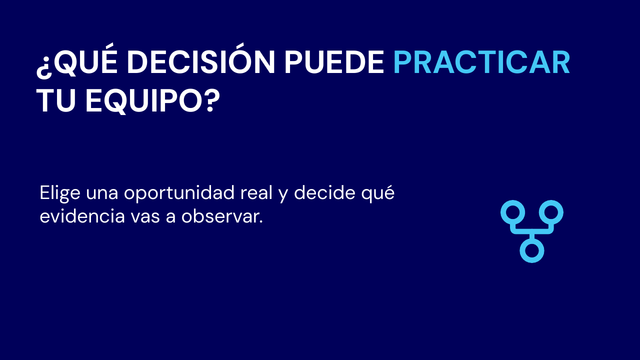

## Nueve capas generadas mediante separación del fondo

Son recursos derivados de los gráficos seleccionados de R12. Se mantiene su proporción y transparencia; las vistas públicas tienen 640 px de ancho.

### R12 017 · Baliza individual y tres balizas enlazadas

ID nativo de R12 301 · Usada en el montaje 017 · [ficha del recurso](https://github.com/nkrikamo/RandyPublic/blob/main/010_SucesionNextGenConnectors/UniversoDeSlides/069_Sucesion_R13_Rescates_aprobados_PENDIENTE_CONCILIACION/capas/R12_017_ID301__capa_alfa.md)

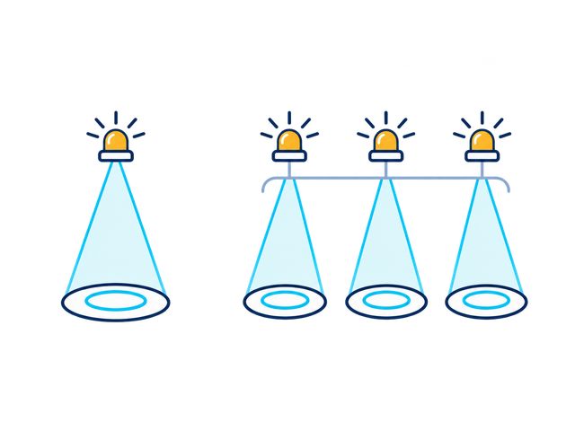

### R12 019 · Huella, brújula y documento verificado

ID nativo de R12 303 · Usada en el montaje 018 · [ficha del recurso](https://github.com/nkrikamo/RandyPublic/blob/main/010_SucesionNextGenConnectors/UniversoDeSlides/069_Sucesion_R13_Rescates_aprobados_PENDIENTE_CONCILIACION/capas/R12_019_ID303__capa_alfa.md)

### R12 021 · Secuencia de escucha, búsqueda, orientación, encaje y revisión

ID nativo de R12 305 · Usada en el montaje 020 · [ficha del recurso](https://github.com/nkrikamo/RandyPublic/blob/main/010_SucesionNextGenConnectors/UniversoDeSlides/069_Sucesion_R13_Rescates_aprobados_PENDIENTE_CONCILIACION/capas/R12_021_ID305__capa_alfa.md)

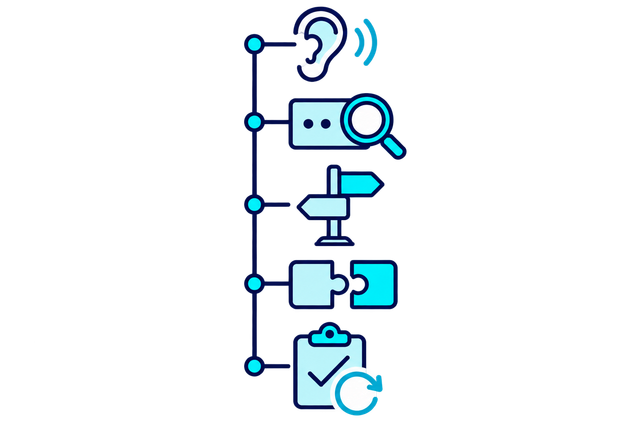

### R12 023 · Seis plataformas/interfaces conectadas

ID nativo de R12 307 · Usada en el montaje 019 · [ficha del recurso](https://github.com/nkrikamo/RandyPublic/blob/main/010_SucesionNextGenConnectors/UniversoDeSlides/069_Sucesion_R13_Rescates_aprobados_PENDIENTE_CONCILIACION/capas/R12_023_ID307__capa_alfa.md)

### R12 024 · Rutas: faro de orientación y barrera

ID nativo de R12 308 · Usada en el montaje 022 · [ficha del recurso](https://github.com/nkrikamo/RandyPublic/blob/main/010_SucesionNextGenConnectors/UniversoDeSlides/069_Sucesion_R13_Rescates_aprobados_PENDIENTE_CONCILIACION/capas/R12_024_ID308__capa_alfa.md)

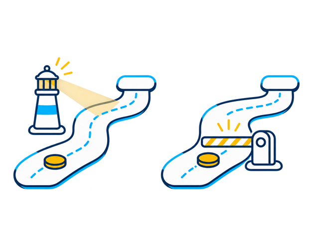

### R12 027 · Dispositivo de acceso con conexión habilitada

ID nativo de R12 311 · Usada en el montaje 025 · [ficha del recurso](https://github.com/nkrikamo/RandyPublic/blob/main/010_SucesionNextGenConnectors/UniversoDeSlides/069_Sucesion_R13_Rescates_aprobados_PENDIENTE_CONCILIACION/capas/R12_027_ID311__capa_alfa.md)

### R12 030 · Red de respaldo y rutas paralelas

ID nativo de R12 314 · Usada en el montaje 026 · [ficha del recurso](https://github.com/nkrikamo/RandyPublic/blob/main/010_SucesionNextGenConnectors/UniversoDeSlides/069_Sucesion_R13_Rescates_aprobados_PENDIENTE_CONCILIACION/capas/R12_030_ID314__capa_alfa.md)

### R12 031 · Dos estados de conexión USB con transferencia

ID nativo de R12 315 · Usada en el montaje 027 · [ficha del recurso](https://github.com/nkrikamo/RandyPublic/blob/main/010_SucesionNextGenConnectors/UniversoDeSlides/069_Sucesion_R13_Rescates_aprobados_PENDIENTE_CONCILIACION/capas/R12_031_ID315__capa_alfa.md)

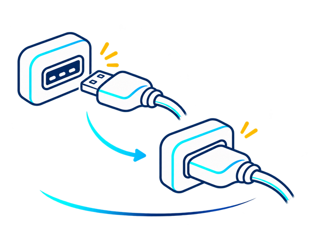

### R12 065 · Nodo de decisión con tres ramas

ID nativo de R12 275 · Usada en el montaje 034 · [ficha del recurso](https://github.com/nkrikamo/RandyPublic/blob/main/010_SucesionNextGenConnectors/UniversoDeSlides/069_Sucesion_R13_Rescates_aprobados_PENDIENTE_CONCILIACION/capas/R12_065_ID275__capa_alfa.md)

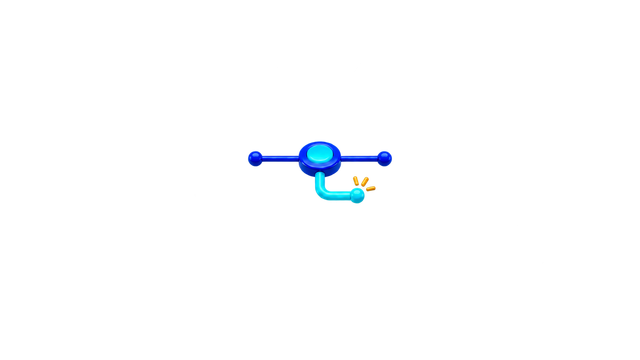

